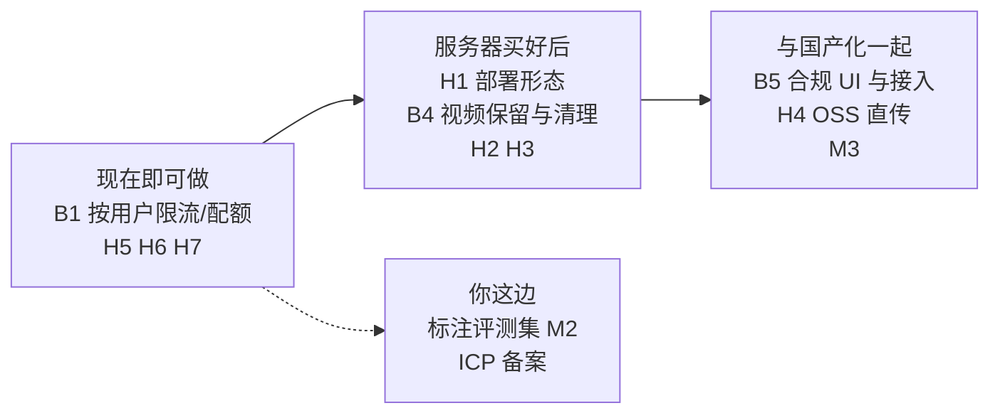

# Topstar 上线检查清单

> **状态**：持续更新。每完成一项就勾选，并在第 7 节记录变更
> **创建日期**：2026-11-08
> **依据**：2026-11-08 对前后端代码的审查（提交 `a31b6f6`）和一次生产构建。每条「现状」都标了依据，**没有真机、压测和服务器环境的验证，这些在「未验证」里单独列出**
> **和迁移计划的关系**：[国产化迁移计划 v2](./Topstar_国产化模型迁移计划_v2.md)管「换国内模型 + 境内部署 + 合规」的排期；本清单管**应用本身**离生产还差什么。两份有交叉的地方（合规、OSS 直传）只在这里列出条目并指向 v2，不重复展开

---

## 0. 决策记录

| # | 决策 | 结论 | 理由 |
|---|---|---|---|
| L1 | VIP 内容首发怎么处理（2026-11-08） | **保留锁定，VIP 由服务端判定** | 首发免费（v2 D3），付费放到上线之后；但锁定必须是真锁，不能让客户端自己声明 |
| L2 | VIP 在没有付费体系时怎么判定 | 默认所有人都不是 VIP；服务端配置 `VIP_ACCESS_TOKENS` 且请求头 `X-Topstar-VIP-Token` 匹配才解锁（默认关闭，仅供内部测试） | 保证上线后能自己验证解锁链路；以后接入付费时替换 `server/auth/vip.ts` 的 `resolveIsVip`（可以直接读用户表），调用方不用改 |
| L3 | 账号体系放在首发（2026-11-08） | **首发做手机号 + 短信验证码登录**，微信登录放到小程序阶段 | 手机号天然唯一，限流 / 配额才真正限得住人；微信 H5 登录需要认证服务号，且只能在微信里用，工作量明显更大 |
| L4 | 哪些功能要登录（2026-11-08） | **对话、视频分析、语音朗读要登录**；首页、聊天页浏览、设置、教程推荐不用 | 所有消耗模型额度的接口都有账号；未登录用户到点击核心功能时弹登录窗口 |

---

## 1. 阻断上线（不解决就不能放给真实用户）

### B1 接口没有鉴权和限流

- [ ] **现状**：`server/index.ts` 只有 `cors()`（全开）和 `helmet()`，没有登录、限流、并发和配额限制。任何人可以无限调用 `/api/v2/chat`、`/tts`、视频分析，**直接烧模型额度**（11 月初额度耗尽就是这类风险的预演）。`GET /api/v2/analysis/jobs/:id` 只凭 UUID 就能读到别人的报告
- [ ] **目标**：
  - 按 IP（或匿名设备标识）限流；对话、TTS、视频上传分别设阈值
  - 视频分析的全局并发 / 排队上限，以及每个访问者的每日次数上限
  - 全局日预算告警：模型费用超过阈值就通知并可一键降级（见 H3、M5）
  - ~~任务结果的读取需要凭证~~ ✅ 已由账号体系解决：任务只能由创建者读取（见 B6）
  - CORS 收紧为自己的域名
- **备注**：账号体系已做（B6），限流和配额直接**按用户**统计，不再需要匿名设备标识（登录接口本身的发送频率限制已在 B6 完成）。**这一项不依赖云服务器，可以先做**

### B2 VIP 判定可被客户端绕过 ✅ 2026-11-08 已完成

- [x] **现状（修复前）**：[handleChatEvent.ts](../../server/orchestrator/handleChatEvent.ts) 里 `isVip = req.prefs?.is_vip === true`，值来自请求体，客户端自己填。直接调接口传 `true` 就能拿到「核心秘诀」
- [x] **已做**：
  - 请求体里所有 VIP 相关字段一律忽略；VIP 只由 `server/auth/vip.ts` 的 `resolveIsVip` 判定（见决策 L1、L2）
  - **顺带发现并修复一个更严重的问题**：知识库里 13 个动作文档的标题是 `## 【核心秘诀】`（两个井号），而「入模前物理剥离秘诀」的正则只认 `###` 或没有井号，**一个都没匹配上**。也就是说非 VIP 用户请求时，秘诀正文一直会进入模型，只靠「出模后过滤」这一道防线；模型要是把秘诀改写进别的章节，过滤就拦不住。现在标题允许 1–6 个井号，并且遇到不认识的标题格式时会保守截断（宁可少给也不放行）
  - 测试：`routes/__tests__/vip.http.test.ts` 通过真实 Express 路由复现原漏洞；`orchestrator/__tests__/vipFilter.test.ts` 用**真实知识库**逐个文档验证剥离效果（这条本来就该有）。我专门把旧漏洞临时加回去验证过，回归测试会失败
- [ ] **仍需你确认**：首发后「核心秘诀」对所有用户永远显示为锁定占位，没有任何解锁入口——这是「保留锁定」的预期结果，但要确认产品上是否可以接受（比如锁定块是否要加一句说明「会员专享」）

### B3 前端依赖境外 CDN，境内大概率白屏或没样式 ✅ 2026-11-08 已完成（内容外链除外）

- [x] **现状（修复前）**：`client/index.html` 引用 Google Fonts（`fonts.googleapis.com`）、**运行时 Tailwind**（`cdn.tailwindcss.com`）、`esm.sh` 的 importmap；生产构建产物里这些境外域名都还在；`client/package.json` 留着没用到的 `@google/genai`
- [x] **已做**：
  - Tailwind 3.4.17 改为构建期编译（`tailwind.config.js` 把原来内联的主题原样搬过来），不再有 CDN 脚本
  - 正文 / 标题字体改用 `@fontsource-variable/noto-sans-sc`、`@fontsource-variable/lexend` 自托管
  - Material Symbols 图标字体从 3.9 MB 全量字体裁成 **12 KB 子集**（只含源码用到的 44 个图标，保留 FILL / 字重轴），生成脚本 `client/scripts/build-icon-font.py`
  - 删除 importmap 和 `@google/genai`（前端从未直接调用 Gemini，只调自己后端的 `/api/v2/*`，所以不影响 Gemini 使用）
  - 构建链加了两道检查：`check:icons`（源码用了子集里没有的图标就失败，避免线上出现空白方块）、`check:dist`（产物里出现境外 CDN 域名 / 绝对外链 / importmap 就失败）。两道检查都用「故意注入问题」验证过确实会拦住
- [x] **验证**：
  - 页面真实加载时发出的请求，全部只指向本站（和 `img1.baidu.com` 封面图），没有 `googleapis` / `gstatic` / `tailwindcss`（修复前是 80+ 次 Google 字体请求）
  - 移动端深色、浅色各 7 个界面（首页、侧栏、设置、外观、对话、报告）与修复前逐像素对比：5 个界面完全一致，设置页只有「VIP」文字行有约 3 px 的宽度差，报告页重拍后差异 0.009%
  - 注意：对比用的是页面 API 的模拟数据，没有走真实后端；前端的调用代码没有改动
- [ ] **仍需处理**（不属于 B3 范围，需要产品决策，`check:dist` 目前只给警告）：
  - 首页和 `App.tsx` 里写死了 `drive.google.com` 的教学视频链接（`App.tsx` 约 241、336 行，`HomeScreen.tsx:18`）：境内打不开，要换成自有存储（OSS）地址
  - 首页封面图用的是 `img1.baidu.com` 的第三方图片（`HomeScreen.tsx:42`）：随时可能失效或防盗链，要换成自有图片
- **备注**：改了 Tailwind 或 PostCSS 配置后，要**重启** `npm run dev`，否则页面会没有样式（我验证时就踩过一次）。还没有在真正断开境外网络的真机 / 浏览器上打开过，见第 6 节

### B4 用户上传的视频从不删除

- [ ] **现状**：代码里没有任何删除上传文件的逻辑，`server/uploads/` 已经 4.0 GB。视频含人脸，属于个人信息；隐私政策必须写明保留期限（v2 待决策项「用户视频保留期限」还没定）；磁盘也迟早写满
- [ ] **目标**：
  - 定保留期限（建议分析完成后立即删除原视频，或最多保留 N 天），写进隐私政策
  - 定时清理任务 + 磁盘占用告警
  - 失败任务的视频也要清理
  - 数据库里的报告和 `trace` 的保留策略一并定（`trace` 里有模型对画面的文字描述）
- **关联**：v2 第 4.2 节「用户视频设置保留期限」

### B5 合规项还没有开始

- [ ] **现状**：设置页有「隐私政策」菜单项，但没有内容，也没有首次进入的同意弹窗；没有 AI 生成内容标识；没有内容安全审核
- [ ] **目标和排期**：见 [v2 第 4.3 节合规线](./Topstar_国产化模型迁移计划_v2.md)（ICP 备案、生成式 AI 登记、隐私政策与同意、内容安全、AI 标识、未成年人）。本清单只记一条：**前端要补隐私同意弹窗和 AI 标识的 UI**（v2 第 4.4 节），后端要补内容安全接入点
- **注意**：TTS 目前是裸 PCM 放在 JSON 里传，没有地方写隐式标识，需要改成 wav / mp3（v2 第 4.3 节）

### B6 账号体系（手机号 + 短信验证码登录）🟡 2026-11-09 阿里云短信通道已接入，待真发联调；协议文本待补

- [x] **现状（修复前）**：没有任何登录；`GET /analysis/jobs/:id` 只凭 UUID 就能读到别人的报告；设置页和侧栏的「樊振东」「剩余积分：100」都是写死的假数据；「退出登录」按钮没接任何逻辑
- [x] **已做（后端）**：
  - 接口：`POST /api/v2/auth/sms/send`、`POST /auth/login`（新手机号自动注册）、`GET /auth/me`、`POST /auth/logout`
  - 对话、TTS、创建分析任务、读取任务都需要登录（401 + `UNAUTHORIZED`）；`requireAuth` 排在文件上传解析之前，**未登录的请求读不到视频内容、也不会在服务器上落盘**
  - 任务归属：`analysis_jobs` 新增 `user_id`，只能由创建者读取，别人的和历史无主任务一律返回 404（这也解决了 B1 里「任务结果读取要凭证」）。**上线前创建的 72 条历史任务没有归属，任何账号都读不到**
  - 手机号只存 HMAC 哈希 + 脱敏展示（`138****0000`），验证码和登录令牌只存哈希，数据库泄露不能直接冒用
  - 防刷：同一手机号 60 秒 1 条、每天 10 条；同一 IP 每天 30 条；验证码 6 位、5 分钟有效、错 5 次作废、新码发出旧码立即作废、一码一用、常量时间比较
  - 令牌 30 天有效，退出登录立即失效；启动时配置不安全直接拒绝启动（缺 `AUTH_SECRET`；生产环境用控制台短信或固定验证码）
- [x] **已做（前端）**：登录窗口（手机号、验证码倒计时、同意协议勾选，不勾选不能发验证码）；未登录点发送 / 选择视频 / 朗读时弹窗并说明原因，输入框内容保留；登录后不自动继续（iOS 要求选文件、播放声音必须发生在点击里），由用户再点一次；设置页和侧栏显示真实脱敏手机号；退出登录真实生效；启动时校验令牌，使用中失效会提示「登录已过期」；同时去掉了假的「剩余积分 / 充值」
- [x] **验证**：后端测试 86 → 120 个（新增账号服务 26 个、HTTP 测试 8 个，并用「临时拿掉鉴权 / 归属条件」确认测试会失败）；真实后端 + 真实浏览器走完 4 个场景（未登录弹窗、登录、刷新保持、退出、验证码错误、没勾选同意、令牌失效），页面请求只有本站
- [ ] **还没做 / 需要你**：
  - ~~阿里云短信接入~~ **已完成（2026-11-09）**：`SMS_PROVIDER=aliyun` 现在走真实通道（`server/auth/aliyunSms.ts`，SendSms OpenAPI + HMAC-SHA1 签名，没引官方 SDK）。配置齐全才启动，缺哪个变量就报哪个；阿里云错误码翻译成排查建议（签名/模板不合法、号码限流、余额不足、Secret 填错、RAM 权限不足等）。
    - **演练开关 `SMS_DRY_RUN`（2026-11-09 加）**：开发环境默认开启——签名 / 模板 / AK 照常校验，但不调用阿里云，只把「本该发什么」打进日志（不花钱、不受签名审批影响）；真发要显式 `SMS_DRY_RUN=0` 或 `npm run verify-sms -- <号码> --real`。**生产环境默认关闭，配了 `SMS_DRY_RUN=1` 会拒绝启动**（避免上线后验证码根本发不出去）
    - 联调两条命令：`npm run verify-sms -- 13800138000` 真发 1 条（约 0.045 元，打印 RequestId）；`npm run verify-sms -- 13800138000 --status` 查这个号码当天的**投递回执**（含运营商错误码的中文解释）——**受理成功 ≠ 送达**，两者要分开看
    - 单测覆盖签名算法、参数拼装、成功 / 业务失败 / HTTP 5xx / 网络异常、密钥不出现在请求和日志里（15 个）
    - **代码链路已打通（2026-11-09）**：签名「乐然同韵」、模板 `SMS_310260589`、变量名 `code`；阿里云受理成功（返回 RequestId），鉴权、模板、限流（60 秒内重发 429）、未勾选同意（`CONSENT_REQUIRED`）、错误验证码、同码二次使用都符合预期
    - ⚠️ **但短信还没真正送达手机**：当天 3 条记录的回执都是 `sendStatus=2` + `PORT_NOT_REGISTERED`（运营商侧无该号码登记端口），常见于签名 / 短信通道审核未完全通过，或号码无效。属阿里云与运营商侧问题，**与代码无关，审批通过后无需改代码**，再跑一次 `verify-sms --status` 确认 `sendStatus=3` 即可
    - 踩过的坑记一笔：阿里云 RPC 签名的 HMAC key 是 `AccessKeySecret + "&"`（末尾那个 `&` 是文档原文，不是笔误）。少了它只会返回 `SignatureDoesNotMatch`，而服务端回显的「server string to sign」和本地算的**一模一样**，极难定位；已用官方文档示例签名 `OLeaidS1JvxuMvnyHOwuJ+uX5qY=` 做单测锁死
  - **《用户协议》《隐私政策》文本**：登录窗口里是占位文字，点不开。文本由你们提供，见 B5
  - 没有压测；没有在微信 / iOS 真机上测过登录窗口（见第 6 节）
- **上线配置**（`server/.env`；变量说明以 `server/auth/aliyunSms.ts` 顶部注释为准，根目录 `.env.example` 在本仓库被 .gitignore 忽略，只是本地样例）：`AUTH_SECRET`（≥32 字符，**上线后不能改**，改了所有用户会变成新用户）、`NODE_ENV=production`、`SMS_PROVIDER=aliyun` + `ALIYUN_SMS_ACCESS_KEY_ID` / `ALIYUN_SMS_ACCESS_KEY_SECRET` / `ALIYUN_SMS_SIGN_NAME` / `ALIYUN_SMS_TEMPLATE_CODE`（可选 `ALIYUN_SMS_TEMPLATE_PARAM`，默认 `code`；`ALIYUN_SMS_REGION_ID`，默认 `cn-hangzhou`）、反向代理后设置 `TRUST_PROXY=1`（否则按 IP 的限制拿到的都是代理的 IP）；可选 `AUTH_SESSION_DAYS`、`SMS_PHONE_DAILY_LIMIT`、`SMS_IP_DAILY_LIMIT`
- **后续**：账号注销 / 数据导出（隐私合规，见 B5）；手机号更换；多设备登录管理

---

## 2. 高优先级（灰度前应完成）

### H1 没有部署形态

- [ ] **现状**：仓库里没有 Dockerfile、进程管理（PM2 / systemd）、反向代理配置和 CI。Express 不托管前端静态文件，生产需要 nginx 同源托管前端 + 转发 `/api`，并放开大文件上传。生产启动是 `tsx index.ts`，`build` 只是类型检查，没有编译产物
- [ ] **目标**：
  - 部署方式定稿（Docker 或 PM2 + nginx），含 HTTPS、`client_max_body_size`、`trust proxy`（拿到真实 IP，限流才准）
  - 固定 Node 版本（`.nvmrc` / `engines`）。我们已经踩过 Node 25 与 22 的 `better-sqlite3` 不兼容；服务器上要装好 ffmpeg / ffprobe（缺了视频时长会留空）
  - 配置清单文档：所有环境变量及默认值（`.env` 不在 git 里，换机器全靠记忆是不行的）
  - CI：至少跑类型检查和 `npm test`
- **依赖**：云服务器（v2 D7，阿里云）

### H2 排障能力不足

- [ ] **现状**：
  - `/api/v2` 请求没有 `request_id`（遗留清单 P1-S13 / S14 未做）
  - `server/video_analysis.log` 没有轮转，且记录了 prompt 和用户内容
  - 没有错误监控和告警
  - `/api/health` 只返回「Key 是否存在」，不检查数据库、磁盘和模型是否可用
  - `uncaughtException` 被捕获后进程继续运行，状态不确定
  - 访问日志用的是开发格式 `morgan('dev')`
- [ ] **目标**：统一错误结构 + `request_id` 透传；日志轮转并脱敏；错误上报；分层健康检查（存活 / 就绪）；致命异常时优雅退出由进程管理器拉起

### H3 任务队列和稳定性

- [ ] **现状**：
  - 分析 Worker 是进程内单线程串行，一个任务 1–3 分钟甚至更长（实测同一视频的 Pass 2 有 8 秒也有 162 秒），用户一多就排队，前端没有排队位置和预估时间
  - 没有最大重试次数：重启时会把所有 `running` 重置成 `queued`，一个会让进程崩溃的视频会无限循环
  - SQLite 单文件，没有备份
  - 模型费用没有上限保护
- [ ] **目标**：最大重试次数和「毒任务」隔离；队列长度上限和排队位置展示；SQLite 定时备份（WAL 模式要用在线备份）；费用日预算与降级开关（配合 B1）；评估是否需要把 Worker 拆成独立进程（`ANALYSIS_WORKER_ENABLED` 已支持）

### H4 视频上传体验

- [ ] **现状**：
  - 没有上传进度（用的 `fetch`，拿不到进度）
  - 前端提示「不能超过 100MB」，后端实际限制 500MB，不一致
  - 大文件先上传到我们的服务器、再转传给模型，手机弱网很容易失败
  - 服务端只按请求声明的 `mimetype` 判断视频格式，可以伪造；视频时长没有上限
  - 微信内置浏览器和 iOS 没有真机测试过
- [ ] **目标**：上传进度（XHR 或分片）；统一大小上限；用 ffprobe 校验真实格式并限制时长；国内版改为直传 OSS 签名 URL（见 v2 第 4.2 节）；微信 / iOS / Android 真机测试矩阵

### H5 前端遗留

- [ ] **现状**：
  - `App.tsx` 里仍有 `setTimeout` 模拟报告的 mock 分支（约 221–249 行，点「接发球技巧」「正手拉球要领」两个快捷入口会触发：返回假报告和 `drive.google.com` 链接，而且点击后并不会真的发消息）
  - 「链接失效」反馈按钮前端没接（后端 `report-dead` 接口已有，遗留清单 P2-F4）
  - ~~设置页有「退出登录」，但根本没有登录体系~~ ✅ 已随账号体系（B6）解决
  - 教程推荐的相关性问题（遗留清单第 2 项）：反手拨球的诊断会推荐一条步法教程
- [ ] **目标**：清理 mock 分支和假入口；接通死链反馈；修教程召回排序

### H6 教程同步链路只能在你的电脑上跑

- [ ] **现状**：`server/scripts/0_sync-tutorials.ts:16` 写死了 `/Users/yingdongma/Documents/Dev/codex/output/pingpong-merged/favorites.json`。教程库的数据来源在你本机，换台机器（包括服务器）就没法更新
- [ ] **目标**：路径改为环境变量或仓库内可配置路径；明确教程数据的来源、同步频率和失败告警；在非你本机的环境演练一次（遗留清单第 3 项）

### H7 通用安全加固

- [ ] **现状**：CORS 全开；`express.json` 上限 10 MB 但没有其他请求体限制；没有统一的全局错误处理中间件（未处理的路由错误会直接抛堆栈）；`helmet` 用默认配置，前端静态资源由 nginx 提供时需要单独配 CSP
- [ ] **目标**：CORS 收紧；统一错误处理（不泄露堆栈）；安全响应头在 nginx 上按前端实际依赖配 CSP；依赖漏洞扫描（`npm audit`）纳入 CI

---

## 3. 中优先级

| # | 事项 | 现状 / 说明 |
|---|---|---|
| M1 | 测试与 CI | 后端 86 个单测（`npm test`，需在 Node 22 下运行），**前端 0 个**，没有端到端测试，没有 CI 和 lint |
| M2 | 评测集与 Gemini 基线 | 工具已完成（`npm run eval`），评测集需要你标注 30 条；**Gemini 基线必须在服务器迁到国内之前采集**。见 [eval/README.md](../../eval/README.md) |
| M3 | 国产化 Phase 1 / 2 | `OpenAICompatibleProvider`、国内模型、OSS、境内部署。见 v2 |
| M4 | 意图评测集 P1-S5 | 遗留清单上线后项，评测脚本目前只覆盖视频分析 |
| M5 | 用户体系（后续部分） | 手机号登录已纳入首发（B6）。后续：付费与 VIP 解锁、账号注销、微信登录（小程序阶段）、对话历史按账号保存（目前侧栏历史是写死的假数据，刷新即丢） |
| M6 | 分析质量 | Pass 2 基本照抄诊断规则；动作分类对模型敏感（同一视频见过一次判对一次判错）；需要评测集来量化 |
| M7 | 前端浏览器兼容 | iOS 微信禁止音频自动播放、流式 / 大文件上传在微信里的表现，需要真机验证 |

---

## 4. 已经具备的（不用再做）

- 前端生产构建能通过，**产物里没有 Gemini Key**（已检查）；Key 全在服务端；产物里没有境外 CDN（构建时自动检查）
- 视频分析链路已解耦：各环节模型独立配置、结构化 trace、上传重试、错误码中立
- 数据库迁移幂等，历史数据兼容
- 后端 86 个单测，含 VIP 的 HTTP 回归测试和真实知识库的剥离验证
- 评测工具和标注模板已就绪
- 上传文件名中文乱码、任务排队延迟已修复

---

## 5. 建议顺序

| 阶段 | 事项 | 为什么放在这里 |
|---|---|---|
| 现在 | B1、H5、H6、H7、M1 的前端部分（B3、B6 代码已完成） | 都不依赖云服务器，做完能立刻降低风险 |
| 服务器就绪后 | H1、B4、H2、H3 | 需要真实的部署环境才能验证 |
| 随国产化 | B5、H4、M3 | 依赖国内模型、OSS 和合规材料 |
| 并行（你） | **申请阿里云短信签名和模板（B6）**、协议文本（B5）、M2 标注评测集、ICP 备案 | 周期最长，越早越好 |

---

## 6. 未验证的部分

下面这些我**没有验证**，上面写「没有」指的是仓库里没有，不排除你在别处配置过：

- 没有压测，不知道单机能撑多少并发
- 账号体系只用「控制台短信 + 固定验证码」测过；**真实短信通道代码已接入（2026-11-09），但还没真正发过一条短信**（等 AccessKey / 签名 / 模板填好）；登录窗口没有在微信、iOS 真机上测过（软键盘弹出时底部弹窗的位置、验证码自动填充）
- 没有微信、iOS、Android 真机测试；前端也没有在真正断开境外网络的环境里打开过（B3 只验证了「页面不再发出境外请求」）
- 没有查看你的服务器和云环境（域名、证书、防火墙、对象存储）
- 没有评估内容安全服务的接入方式（取决于云厂商）

---

## 7. 变更记录

| 日期 | 说明 |
|---|---|
| 2026-11-08 | 初版：依据代码审查整理阻断 / 高 / 中三级清单，记录决策 L1、L2，建议顺序与未验证项 |
| 2026-11-08 | B2（VIP）完成：VIP 改为服务端判定，请求体字段一律忽略，新增 `server/auth/vip.ts` 与默认关闭的内部测试令牌；修复知识库 `## 【核心秘诀】` 标题没被入模前剥离正则匹配的问题（13 个动作文档的秘诀正文此前会进入模型），新增 `server/orchestrator/vipFilter.ts`（含保守兜底）、HTTP 回归测试和真实知识库验证测试；后端测试 77 → 86 个 |
| 2026-11-08 | B3（前端去境外 CDN）完成：Tailwind 改构建期编译；Noto Sans SC / Lexend 自托管；Material Symbols 裁成 12 KB 子集；删除 importmap 和未使用的 `@google/genai`；构建链新增 `check:icons`、`check:dist`；深色 / 浅色各 7 个界面做了像素对比。同时记录新发现：Google Drive 视频链接和百度封面图仍是境外 / 第三方内容依赖（B3 备注），H5 补充 mock 分支细节；`client/README.md` 重写 |
| 2026-11-09 | **阿里云短信真发联调通过**：修正 RPC 签名 bug（HMAC key 必须是 `AccessKeySecret + "&"`，此前误用裸 Secret，表现为 `SignatureDoesNotMatch` 且服务端回显的待签名串与本地完全一致）；新增官方文档示例签名的回归测试；端到端验证「发码 → 登录 → /me → 退出」全链路（验证码取自阿里云发送记录，不依赖手机）；新增 `verify-sms --status` 回执查询（`QuerySendDetails`，同样自实现签名），用于区分「受理成功」与「真正送达」；`server/.env` 关闭 `SMS_FIXED_CODE`（改用真实验证码）。同时确认：官方 SDK 与本地实现的签名在相同输入下一致。**未完成：投递回执至今全部是 `PORT_NOT_REGISTERED`，等签名 / 通道审批通过** |
| 2026-11-09 | **阿里云短信通道接入完成**：新增 `server/auth/aliyunSms.ts`（SendSms OpenAPI，HMAC-SHA1 自实现签名，未引官方 SDK；缺配置启动即失败并指出缺哪个变量；错误码翻译成排查建议）；`SMS_PROVIDER=aliyun` 不再报「尚未实现」；新增 `npm run verify-sms -- <手机号>` 真发联调脚本；根目录 `.env.example` 补全账号体系与短信变量（此前只有 Gemini / PORT）。未完成：真实发送未联调（等 AccessKey 与签名模板），仍需压测与真机 |
| 2026-11-08 | 新增 **B6 账号体系（手机号 + 短信验证码登录）**并完成代码：决策 L3（首发做手机号登录，微信放小程序阶段）、L4（对话 / 视频分析 / TTS 要登录，其余免登录）；后端新增 `server/auth/` 账号服务与 `/api/v2/auth/*`，对话 / TTS / 创建任务 / 读任务全部要求登录，任务按用户归属（历史 72 条任务无主）；前端新增登录窗口与登录态，设置页和侧栏改为真实用户信息，去掉假的「剩余积分」；B1 里「任务结果要凭证」由此解决，限流改为按用户；H5 的「退出登录没有登录体系」解决；M5 改为后续部分；未完成项：阿里云短信接入（等签名模板）、协议文本、真机测试 |
