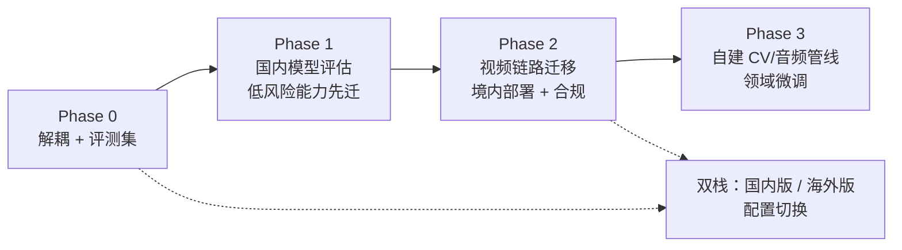
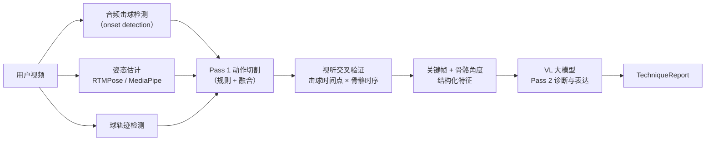

# Topstar 国产化模型迁移计划 v1

> **状态**：规划中（尚未开始实施）
> **创建日期**：2026-10-15
> **适用范围**：面向中国大陆用户的生产环境
> **核心结论**：长期在大陆用 Gemini 服务 C 端用户走不通。要分阶段迁到国内已备案的模型，同时把核心能力（动作切割、视听验证、领域数据）握在自己手里，降低对单一超强多模态大模型的依赖。

> [!IMPORTANT]
> 本文的合规部分是基于公开法规的概括，**不构成法律意见**。正式上线前请找熟悉生成式 AI 备案的律师确认。国内模型更新很快，文中列的具体型号均为「候选」，选型时以各平台最新文档为准。

---

## 1. 背景与问题

Topstar 目前所有 AI 能力（对话、意图识别、视频分析、TTS、图片生成）都依赖 Google Gemini API。选它主要看中的是多模态能力，特别是原生的长视频 + 音频联合理解。但目标用户主要在中国大陆，这带来以下长期风险：

| 风险 | 说明 | 严重度 |
|---|---|---|
| **合规：生成式 AI 备案** | 根据《生成式人工智能服务管理暂行办法》，面向大陆公众提供生成式 AI 服务需要做算法备案和生成式 AI 服务备案/登记。底层用的是没在国内备案的境外模型，这一关过不了。应用商店上架、ICP 备案也越来越常核查这一点 | 🔴 阻断级 |
| **合规：数据出境** | 用户的打球视频（含人脸、体态）是个人信息，现在会上传到 Google Files API，属于数据出境。按《个人信息保护法》，需要走安全评估、签标准合同或做认证 | 🔴 阻断级 |
| **合规：AI 内容标识** | 《人工智能生成合成内容标识办法》（2025-09 起施行）要求 AI 生成的内容带显式和隐式标识。项目里 TTS 语音和生成的图片都在这个范围内 | 🟠 高 |
| **服务条款** | 中国大陆不在 Gemini API 的支持地区列表里。用它服务不支持地区的用户，账号有被封的风险，业务会整体中断 | 🟠 高 |
| **体验与稳定性** | 服务器只能部署在海外。视频上传慢，跨境链路不稳 | 🟡 中 |

---

## 2. 现状：Gemini 依赖盘点

### 2.1 按能力划分

| 能力 | 当前模型 | 代码位置 | 迁移难度 |
|---|---|---|---|
| 对话编排 | `gemini-3-flash-preview` | [handleChatEvent.ts](../../server/orchestrator/handleChatEvent.ts) | 🟢 低 |
| 意图识别（LLM 兜底） | `gemini-3-flash-preview` | [intentRouter.ts](../../server/intent/intentRouter.ts) | 🟢 低 |
| 旧版对话 | `gemini-3-flash-preview` | [v1.ts](../../server/routes/v1.ts) | 🟢 低 |
| TTS | `gemini-2.5-flash-preview-tts` | [v1.ts](../../server/routes/v1.ts)、[v2.ts](../../server/routes/v2.ts) | 🟢 低 |
| 图片生成 | `gemini-2.5-flash-image` | [v1.ts](../../server/routes/v1.ts) | 🟢 低 |
| 视频 Pass 1 切割 / Pass 2 诊断 | `gemini-3.1-pro-preview` → `gemini-2.5-pro` → `gemini-2.5-flash` | [handleAnalysisJob.ts](../../server/orchestrator/handleAnalysisJob.ts) | 🟠 中到高 |
| 视频 Pass 1.5 技术分类 | 由调用方传入 | [techniqueClassifier.ts](../../server/videoAnalysis/techniqueClassifier.ts) | 🟠 中 |
| 视频文件托管 | Gemini Files API（上传 → 轮询 ACTIVE → 清理） | [handleAnalysisJob.ts](../../server/orchestrator/handleAnalysisJob.ts) | 🟠 中 |
| **视听交叉验证** | 依赖 Gemini 原生的音视频联合理解 | 视频分析链路 | 🔴 高 |

### 2.2 关键耦合点

- `@google/genai` SDK 直接在 [v1.ts](../../server/routes/v1.ts) / [v2.ts](../../server/routes/v2.ts) 中引入。模型名硬编码在 5 个以上的文件里。
- 视频链路和 Files API 的生命周期绑在一起，`analysis_jobs` 表里存的也是 Gemini 文件引用。
- 前端服务层文件叫 [geminiService.ts](../../client/geminiService.ts)，实际走的是自家后端，耦合只在命名上。
- 专利交底书里 Gemini 只作为背景举例出现。[专利分析报告](../patent_disclosures/专利分析报告.md) 已经约定「权利要求中不要出现具体的模型名称」，后续请继续遵守。

### 2.3 真正难迁的部分

文本、TTS、图片这几块国内都有成熟的替代方案。**真正难迁的只有视频链路**，它依赖三项能力：

1. 长视频直接输入
2. 准确的时间戳定位（Pass 1 切割）
3. 音视频联合理解（视听交叉验证）。国内多数视觉模型只看画面帧，不处理音轨。

---

## 3. 总体策略



**三条原则**：

1. **先解耦，再替换**：没有抽象层就换模型，只是换了一个地方被锁定。
2. **用数据决策**：用评测集客观比较模型，不凭感觉选。
3. **护城河在领域数据和管线上，不在底座模型上**：大模型只负责「诊断和表达」。

---

## 4. 分阶段计划

### Phase 0：准备（与换不换模型无关，可以立刻开始）

**目标**：业务代码不再直接依赖 Gemini，并建立可以量化比较模型效果的评测基线。

#### 0.1 模型抽象层 `LLMProvider`

把所有 `@google/genai` 调用收进 adapter，业务代码只依赖接口。

```ts
// server/llm/types.ts（示意）
interface LLMProvider {
  chat(req: ChatRequest): Promise<ChatResult>;                 // 文本对话 / 意图识别
  analyzeVideo(req: VideoAnalysisRequest): Promise<VideoResult>; // Pass 1 / 1.5 / 2
  tts(req: TTSRequest): Promise<AudioResult>;
  generateImage(req: ImageRequest): Promise<ImageResult>;
}

// 视频输入与文件托管解耦：Gemini 用 Files API，国内模型一般用 OSS 签名 URL
interface VideoStorage {
  upload(localPath: string): Promise<VideoRef>;
  waitReady(ref: VideoRef): Promise<void>;
  cleanup(ref: VideoRef): Promise<void>;
}
```

- [ ] 新建 `server/llm/`，实现 `GeminiProvider`（行为和现在完全一致）
- [ ] 模型名、降级链、provider 选择全部配置化（环境变量或配置文件），每项能力单独配置
- [ ] 结构化输出（JSON Schema）在 adapter 层统一做校验和修复，屏蔽各家 JSON mode 的差异
- [ ] `analysis_jobs` 中 Gemini 文件引用字段泛化为 `provider` + `file_ref`
- [ ] （可选）`client/geminiService.ts` 更名为 `aiService.ts`

**验收**：业务目录（`orchestrator/`、`intent/`、`videoAnalysis/`、`routes/`）中不再出现 `@google/genai` 引用和硬编码模型名。线上行为没有变化。

#### 0.2 评测集（最重要的资产）

- [ ] 收集 50–200 条有代表性的视频，覆盖不同技术动作、机位、光线、画质和正反手
- [ ] 请教练标注：有效片段的时间范围、动作类别、主要问题点和改进建议
- [ ] 把现在 Gemini 的输出保存下来作为基线
- [ ] 写评测脚本 `server/scripts/evalVideo.ts`，指标如下：

| 指标 | 对应环节 | 说明 |
|---|---|---|
| 片段时间戳误差 / IoU | Pass 1 | 与标注片段比较 |
| 动作分类准确率 | Pass 1.5 | |
| 诊断一致性评分 | Pass 2 | 教练盲评 1–5 分，或 LLM-as-judge 辅助 |
| JSON Schema 通过率 | 全链路 | 结构化输出的稳定性 |
| 端到端耗时（P50/P95） | 全链路 | |
| 单条视频成本 | 全链路 | |

**验收**：一条命令就能对任意 provider 和模型组合跑完评测，输出对比报告。

---

### Phase 1：国内模型评估 + 低风险能力先迁

**目标**：完成国内模型选型，先把文本、TTS、图片切过去。

#### 1.1 候选模型（选型时需核实最新版本）

| 能力 | 候选 |
|---|---|
| 文本对话 / 意图识别 | 通义千问（阿里云百炼）、豆包（火山方舟）、DeepSeek、GLM（智谱）、Kimi |
| 视频理解 | **Qwen-VL / Qwen-Omni 系列**（Omni 能同时处理音视频，最贴近视听交叉验证）、豆包 Seed 视觉模型、智谱 GLM-V 系列 |
| TTS | 火山引擎语音合成、阿里 CosyVoice、MiniMax Speech |
| 图片生成 | 通义万相、即梦 / Seedream |

#### 1.2 任务

- [ ] 为 2–3 家候选实现 Provider adapter
- [ ] 在评测集上跑影子对比（同样的输入并行调用，只记录结果，不返回给用户）
- [ ] 确定每项能力的主力模型和兜底模型。现在 `pro → 2.5-pro → flash` 的降级链思路可以照搬，也可以跨厂商降级
- [ ] 先切对话、意图识别、TTS、图片（低风险、容易回滚）
- [ ] 按国内模型的风格调整 prompt。[UNIFIED_COACH_INSTRUCTION](../../client/geminiService.ts) 和模板校验器要回归验证

**验收**：文本、TTS、图片在评测和人工抽检中不低于 Gemini 基线。可以按配置一键切回。

---

### Phase 2：视频链路迁移 + 境内部署 + 合规

**目标**：大陆生产环境完全不依赖境外模型和境外存储，满足上线所需的合规要求。

#### 2.1 视频链路

- [ ] 用对象存储（阿里云 OSS / 火山 TOS）+ 签名 URL + 生命周期自动删除，替代 Files API 的上传、轮询、清理流程
- [ ] 视频接入国内主力模型。如果模型不支持长视频直接输入，就在服务端先抽帧或按片段切分，再分批送入
- [ ] 视听交叉验证：评估 Qwen-Omni 这类全模态模型。如果效果不达标，提前上 Phase 3.1 的音频击球检测方案作为替代
- [ ] 评测集指标达到预设门槛之后，按灰度比例切流

#### 2.2 境内部署

- [ ] 服务器、数据库、对象存储全部迁到境内云
- [ ] 用户视频和分析结果只存境内，并设定保留期限

#### 2.3 合规清单

- [ ] ICP 备案
- [ ] 生成式 AI 服务登记/备案（调用已备案的国内模型 API 时，应用侧流程相对简单。具体按属地网信部门要求办）
- [ ] 算法备案（如果用到推荐算法，例如教程推荐）
- [ ] AI 生成内容标识：TTS 音频、生成的图片和 AI 回复要加显式标识，文件元数据中加隐式标识
- [ ] 隐私政策和用户协议更新：说明收集视频的目的、保留期限、第三方模型服务商。涉及人脸时评估是否属于敏感个人信息，需要单独取得同意
- [ ] 未成年人保护评估（乒乓球用户中可能有青少年）
- [ ] 内容安全：输入输出接入内容审核

**验收**：大陆生产环境的网络出口里不再有 Google API 请求。合规材料齐全，可以通过应用商店上架审核。

---

### Phase 3：降低对单一多模态大模型的依赖（长期护城河）

**核心思路**：把链路拆开。确定性的感知任务交给专用小模型，大模型只负责「诊断和表达」。



#### 3.1 感知管线

- [ ] **音频击球检测**：用起始点检测或轻量分类模型定位击球时间点
- [ ] **姿态估计**：提取骨骼关键点时间序列，算出关节角度、挥拍速度等特征
- [ ] **Pass 1 切割**：融合击球时间点和动作特征来定位片段。不再依赖大模型输出的时间戳
- [ ] **视听交叉验证**：改成用「音频击球时间点 + 骨骼时序」做验证，不再依赖模型原生的音频理解

**收益**：便宜、快、结果可复现，能在境内甚至端侧运行。换哪家大模型都不影响这部分。

#### 3.2 诊断增强与领域微调

- [ ] Pass 2 输入从「整段视频」改为「关键帧 + 结构化骨骼角度数据 + 知识库」。数据有了结构，换哪家模型诊断都更准
- [ ] 积累足够的标注数据之后，用开源 VL 模型（如 Qwen-VL 开源权重）在自有乒乓球数据上微调，自部署或托管
- [ ] 评估自研模型自己做备案的必要性和成本

**验收**：Pass 1 和视听验证不再调用大模型。Pass 2 可以在至少两家模型之间自由切换，评测指标差距在可接受范围内。

---

## 5. 双栈策略

| 部署 | 模型 | 存储 | 说明 |
|---|---|---|---|
| 中国大陆版 | 国内已备案模型 / 自研微调模型 | 境内对象存储 | 主力市场 |
| 海外版（如果以后做） | Gemini 等 | 海外存储 | Phase 0 完成后只需切配置 |

两套部署共用业务代码、评测集和感知管线，只是 Provider 配置和部署区域不同。

---

## 6. 风险与应对

| 风险 | 应对 |
|---|---|
| 国内模型的视频理解效果不如 Gemini | 用评测集量化差距。Phase 3 的结构化特征可以弥补模型能力的不足 |
| 国内模型不支持音视频联合输入 | 优先评估 Omni 类模型。兜底方案是 Phase 3.1 的音频击球检测 |
| prompt 迁移后输出格式不稳定 | adapter 层统一做 JSON Schema 校验、修复和重试，模板校验器回归测试 |
| 合规流程周期长 | Phase 1 期间就开始准备材料，和技术迁移并行推进 |
| 模型厂商更新频繁、接口变化 | 抽象层隔离，加上评测集，每次换版本都跑一遍回归 |

---

## 7. 待决策事项

- [ ] 大陆版正式上线的时间点（决定 Phase 2 的截止期限）
- [ ] 评测集规模和教练标注资源由谁负责
- [ ] 境内云厂商选型（会影响模型、存储、TTS 的打包选择，例如阿里云全家桶还是火山引擎全家桶）
- [ ] 是否规划海外版（决定 `GeminiProvider` 要不要长期维护）
- [ ] Phase 3 的启动条件（例如评测集里视听验证指标没达标时提前启动）

---

## 8. 变更记录

| 日期 | 版本 | 说明 |
|---|---|---|
| 2026-10-15 | v1 | 初版，根据国产化迁移讨论整理 |
