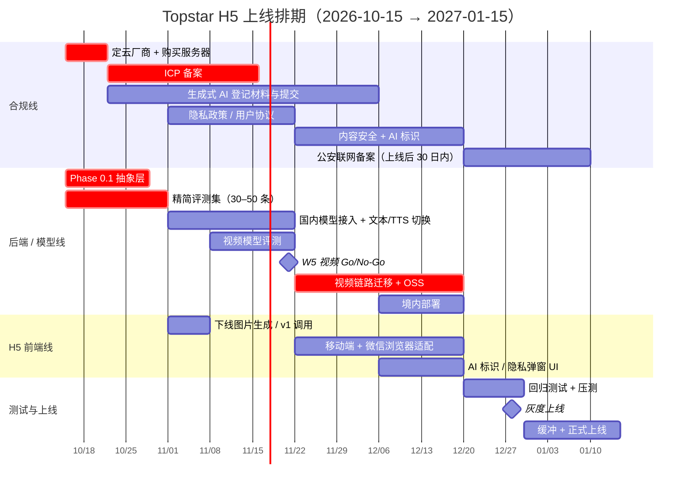

# Topstar 国产化模型迁移计划 v2（H5 优先 · 3 个月上线版）

> **状态**：已确认路线，待启动
> **创建日期**：2026-10-15
> **上一版**：[Topstar_国产化模型迁移计划_v1.md](./Topstar_国产化模型迁移计划_v1.md)（长期规划版。v1 中背景分析、依赖盘点、Phase 3 的内容仍然有效）
> **上线目标**：**12 月下旬灰度上线，2027-01-15 前正式上线**（2027 年春节是 2 月 6 日，节前留出缓冲）

> [!IMPORTANT]
> 本文的合规部分是基于公开法规的概括，**不构成法律意见**。ICP 备案、生成式 AI 登记等具体要求，请向云厂商备案顾问、属地网信部门或律师确认。国内模型更新很快，文中列的具体型号均为「候选」，选型时以各平台最新文档为准。

---

## 0. 关键决策记录

| # | 决策 | 结论 | 理由 |
|---|---|---|---|
| D1 | 上线渠道 | **首发只做 H5**，小程序放到上线之后 | H5 不用重写前端，也不需要小程序备案和类目资质审核，大约省出 4–6 周 |
| D2 | 运营主体 | **企业主体**（已有） | ICP 备案、生成式 AI 登记、后续开通支付都需要 |
| D3 | 收费 | **首发免费或公测**，VIP 付费放到上线之后 | 在线收费一般需要 ICP 经营许可证，门槛高、周期长，暂时避开 |
| D4 | 模型 | **上线前完成国产化**（v1 的 Phase 0–2） | 境内服务器访问不了 Gemini。监管看的是是否面向大陆公众提供服务，和渠道无关 |
| D5 | 部署 | **服务器、数据库、对象存储全部在境内** | ICP 备案的要求；保证访问体验；避免数据出境 |
| D6 | 首发范围 | **砍掉图片生成和 `/api/v1` 旧接口** | 少迁一项是一项，集中精力做核心体验 |

---

## 1. 为什么国产化是上线的前提

详细分析见 [v1 第 1 节](./Topstar_国产化模型迁移计划_v1.md#1-背景与问题)。总结如下：

- **境内服务器访问不了 Gemini**。如果绕道海外代理，用户视频就变成出境，合规风险更大。
- 面向大陆公众提供生成式 AI 服务，**不管走 H5 还是小程序**，都要满足备案/登记、AI 内容标识、个人信息保护等要求。
- H5 没有小程序那样的平台审核，能先上线，但**风险没有消失，只是往后推了**。等用户量起来、需要做小程序或开通付费时，问题会集中爆发。

---

## 2. 首发范围

| 功能 | 首发 | 说明 |
|---|---|---|
| AI 教练对话（编排式 chat，`/api/v2`） | ✅ | 核心 |
| 意图识别 | ✅ | 核心 |
| 教程推荐 | ✅ | 不涉及生成式模型，风险低 |
| TTS 语音播报 | ✅ | 需要加 AI 生成标识 |
| 视频动作分析（Pass 1 / 1.5 / 2） | ⚠️ 视 W5 评测结果而定 | 见第 5 节 Plan B |
| 图片生成（`gemini-2.5-flash-image`） | ❌ 砍掉 | 非核心，少迁一项 |
| `/api/v1` 旧接口 | ❌ 下线 | 只保留 v2 |
| VIP 付费 | ❌ 上线后再做 | 等 ICP 证，见第 7 节 |
| 小程序 | ❌ 上线后再做 | 见第 7 节 |

---

## 3. 13 周排期

### 3.1 总览

### 3.2 分阶段明细

| 周次 | 日期 | 合规线 | 后端 / 模型线 | H5 前端线 |
|---|---|---|---|---|
| **W1–2** | 10/15–10/31 | **定云厂商**（见 4.1）；按云厂商要求购买满足备案条件的服务器；**提交 ICP 备案**；了解属地生成式 AI 登记的流程和材料 | **Phase 0.1 抽象层**；**精简评测集** | — |
| **W3–5** | 11/1–11/21 | 跟进 ICP 备案；和模型厂商签约，拿到调用证明（登记材料要用）；起草隐私政策和用户协议 | 国内模型 adapter；**对话、意图识别、TTS 切到国内**；视频模型评测。**W5 末做视频 Go/No-Go** | 删除图片生成和 v1 接口的调用 |
| **W6–9** | 11/22–12/19 | 接入内容安全审核（输入和输出）；AI 内容标识方案；提交生成式 AI 登记 | 视频链路改用对象存储 + 国内模型；**境内部署**（服务器、SQLite / 数据库、对象存储） | 移动端适配；微信内置浏览器兼容；AI 标识和隐私同意 UI |
| **W10–11** | 12/20–1/2 | 网站上线后 30 日内完成公安联网备案 | 回归测试（评测集 + 人工）；压测；监控告警 | 真机测试（iOS / Android × 微信 / 系统浏览器） |
| **W12–13** | 1/3–1/15 | — | 修问题 | 修问题，**正式上线** |

### 3.3 里程碑与检查点

| 里程碑 | 时间 | 通过标准 | 未通过时怎么办 |
|---|---|---|---|
| **M1 合规启动** | 10/31 | 云厂商已定，ICP 备案已提交 | 每拖一周，上线日期顺延一周 |
| **M2 解耦完成** | 10/31 | 业务代码中不再有 `@google/genai` 和硬编码模型名；评测集能一条命令跑完 | 压缩 W3–5 的模型对比范围，只评估 1–2 家 |
| **M3 视频 Go/No-Go** | 11/21 | 国内模型在评测集上达到预设门槛（见 5.2） | 启用 Plan B（见第 5 节） |
| **M4 功能冻结** | 12/19 | 境内环境全功能可用；大陆生产环境的网络出口里不再有 Google API 请求 | 砍掉未完成的功能，不推迟上线 |
| **M5 灰度上线** | 12/28 左右 | ICP 备案已通过；内容安全和 AI 标识已上线 | 只做邀请制内测 |
| **M6 正式上线** | 1/15 前 | 灰度期间没有 P0 问题 | 春节后再上线 |

---

## 4. 各条线任务明细

### 4.1 云厂商选型（W1 必须定）

| 维度 | 阿里云 | 腾讯云 | 火山引擎 |
|---|---|---|---|
| 视频理解模型 | 通义 Qwen-VL / **Qwen-Omni**（能同时处理音视频，最贴近视听交叉验证） | 混元视觉 | 豆包 Seed 视觉模型 |
| 文本模型 | 通义千问；百炼平台上也能调用 DeepSeek 等第三方模型 | 混元；也可以调用 DeepSeek | 豆包；方舟平台上也能调用 DeepSeek |
| TTS | CosyVoice | 腾讯云 TTS | 火山语音（效果口碑较好） |
| 对象存储 | OSS | COS | TOS |
| 小程序生态（后续） | 一般 | **好**（微信云托管） | 一般 |

> [!TIP]
> 建议把**视频理解模型的效果**作为第一选型标准，因为它是唯一的难点，其他能力各家差距不大。如果 W1 来不及评测，可以先选模型最全的平台买服务器、启动备案。模型调用走 API，并不一定要和服务器在同一家云，后续可以混用。

### 4.2 后端 / 模型线

#### Phase 0.1 抽象层（W1–2）

接口设计见 [v1 0.1 节](./Topstar_国产化模型迁移计划_v1.md#01-模型抽象层-llmprovider)。按 3 个月上线的要求做了精简：

- [ ] 新建 `server/llm/`：定义 `LLMProvider`（`chat` / `analyzeVideo` / `tts`）和 `VideoStorage` 接口。首发去掉 `generateImage`
- [ ] 实现 `GeminiProvider`，行为和现在完全一致，作为对比基线
- [ ] 模型名、降级链、provider 选择全部改成环境变量，每项能力单独配置
- [ ] adapter 层统一做 JSON Schema 校验、修复和重试
- [ ] `analysis_jobs` 中 Gemini 文件引用字段泛化为 `provider` + `file_ref`
- [ ] 下线 `/api/v1` 路由

#### 精简评测集（W1–2）

- [ ] 30–50 条视频，覆盖主要技术动作和常见的拍摄条件
- [ ] 教练标注：片段时间范围、动作类别、主要问题点
- [ ] 保存当前 Gemini 的输出作为基线
- [ ] 评测脚本 `server/scripts/evalVideo.ts`，指标见 [v1 0.2 节](./Topstar_国产化模型迁移计划_v1.md#02-评测集最重要的资产)
- [ ] 顺带完成 [Phase1_Leftovers_TODO](../coding_plan/phase1/Topstar_Phase1_Leftovers_TODO.md) 里的 **P1-S5 意图评测集**（30–50 条）

> 200 条的完整评测集放到上线之后补。

#### 国内模型接入（W3–5）

- [ ] 为 1–2 家候选实现 Provider adapter（优先选定云厂商的模型）
- [ ] 对话、意图识别、TTS 切换到国内模型，并调整 prompt。[UNIFIED_COACH_INSTRUCTION](../../client/geminiService.ts) 和模板校验器要做回归
- [ ] 视频模型在评测集上和 Gemini 基线对比

#### 视频链路迁移 + 境内部署（W6–9）

- [ ] 用对象存储 + 签名 URL + 生命周期自动删除，替代 Gemini Files API 的上传、轮询、清理流程
- [ ] Pass 1 / 1.5 / 2 接入国内模型。如果模型不支持长视频直接输入，就先抽帧或按片段切分
- [ ] 视听交叉验证：优先用 Omni 类模型；效果不够就降级（见 5.1）
- [ ] 境内部署：后端、数据库、对象存储；[linkHealthCheck](../../server/jobs/linkHealthCheck.ts) 等定时任务一并迁移
- [ ] 用户视频设置保留期限（例如分析完成后 N 天自动删除）

### 4.3 合规线

| 事项 | 时间 | 说明 |
|---|---|---|
| ICP 备案 | W1 提交，大约 W4–5 通过 | 用企业主体；先按云厂商要求买好服务器 |
| 模型厂商调用证明 | W3–5 | API 服务合同或调用证明，生成式 AI 登记时要用 |
| 生成式 AI 应用登记 | W3 准备，W6–9 提交 | 调用已备案的模型，应用侧流程相对简单。**具体材料和时限向属地网信部门确认** |
| 隐私政策 / 用户协议 | W3–5 | 写明视频收集目的、保留期限、第三方模型服务商；涉及人脸时评估是否属于敏感个人信息，需要单独取得同意 |
| 内容安全审核 | W6–9 | 用户输入（文本、视频）和模型输出都要接入云厂商的内容审核服务 |
| AI 生成内容标识 | W6–9 | 对话回复、TTS 音频加显式标识（界面文字或提示音），文件元数据中加隐式标识 |
| 公安联网备案 | 上线后 30 日内 | |
| 未成年人保护 | W6–9 | 乒乓球用户中可能有青少年，评估是否需要年龄提示或监护人同意 |

### 4.4 H5 前端线

现有的 React + Vite 前端**不需要重写**，只做以下适配：

- [ ] 删除图片生成和 v1 接口的调用；清理 [Leftovers](../coding_plan/phase1/Topstar_Phase1_Leftovers_TODO.md) 里的 mock 报告和硬编码的假链接
- [ ] **视频上传**：在微信内置浏览器里测试 `<input type="file" accept="video/*">`；大文件改为分片上传或直传对象存储（签名 URL），并显示上传进度
- [ ] **TTS 播放**：移动端浏览器（尤其 iOS 微信）禁止自动播放音频，需要用户点击后才能播放
- [ ] **流式回复**：确认在微信浏览器里能正常工作，必要时提供非流式降级方案
- [ ] 移动端布局、安全区域适配、横竖屏
- [ ] 首次进入时弹出隐私政策同意；AI 回复带标识
- [ ] （可选）微信分享卡片：需要公众号 JS-SDK，绑定已经 ICP 备案的域名。首发可以不做

---

## 5. 视频分析的 Plan B

### 5.1 降级方案（W5 未通过时按顺序考虑）

| 方案 | 说明 | 用户感知 |
|---|---|---|
| **B1 精简链路** | 保留 Pass 1.5 分类和 Pass 2 诊断；Pass 1 改为让用户自己裁剪、只上传单个动作片段（例如限 10 秒） | 多一步操作，但诊断质量有保障 |
| **B2 去掉视听交叉验证** | 只做视觉分析，把音频验证放到上线之后，由 [v1 Phase 3](./Topstar_国产化模型迁移计划_v1.md#phase-3降低对单一多模态大模型的依赖长期护城河) 的击球声检测补上 | 基本无感，准确率可能稍有下降 |
| **B3 Beta 限量** | 视频分析标记为「Beta」，每个用户限定次数 | 预期管理 |
| **B4 首发不上视频分析** | 首发只上对话和教程推荐，视频分析作为第二版的卖点 | 核心卖点推迟 |

### 5.2 Go/No-Go 门槛（W3 前和教练一起定好具体数值）

- 动作分类准确率 ≥ Gemini 基线的 X%
- 诊断一致性（教练盲评）≥ Y 分
- JSON Schema 通过率 ≥ 95%
- 单条视频端到端耗时 P95 ≤ Z 秒

---

## 6. 开发约束（立即生效）

即日起，所有新代码遵守以下规则，避免在迁移完成前增加新的耦合：

1. 新代码**不再直接** `import '@google/genai'`，统一走现有的 `getAI()` 入口。抽象层完成后改走 `LLMProvider`
2. 新增的模型名放在常量或环境变量里，**不在业务代码里硬编码**
3. 新功能要考虑到在境内部署：不依赖境外服务（字体、CDN、第三方 API 都要检查）

---

## 7. 上线之后的路线

| 事项 | 建议时间 | 前置条件 | 说明 |
|---|---|---|---|
| **评测集扩充到 200 条** | 上线后 1 个月内 | 有真实用户数据（需要用户授权） | |
| **VIP 付费** | ICP 证下来之后 | **ICP 经营许可证（ICP 证）** | 门槛比 ICP 备案高，周期长，建议上线后尽快启动申请；H5 支付需要接入微信支付 / 支付宝 |
| **小程序版** | 上线后 1–3 个月 | 小程序备案 + 类目资质 | Taro 重写前端。**境内后端、国内模型、ICP 备案、生成式 AI 登记都可以直接复用**；可以用已登记的结果和模型厂商合同应对类目审核；iOS 虚拟支付有平台规则限制 |
| **Phase 3 感知管线** | 上线后持续推进 | — | 击球声检测、姿态估计、领域微调，见 [v1 Phase 3](./Topstar_国产化模型迁移计划_v1.md#phase-3降低对单一多模态大模型的依赖长期护城河) |
| **海外版（如果做）** | 待定 | 抽象层 | 只需切换到 `GeminiProvider` 配置 |

---

## 8. 风险与应对

| 风险 | 可能性 | 影响 | 应对 |
|---|---|---|---|
| ICP 备案或生成式 AI 登记拖延 | 中 | 🔴 上线推迟 | W1 就启动；灰度阶段可以先做邀请制内测 |
| 国内模型视频效果不达标 | 中 | 🟠 核心卖点打折 | W5 检查点 + 第 5 节 Plan B |
| 一个人同时推进三条线，人手不够 | 高 | 🟠 进度延误 | 严格控制首发范围；M4 功能冻结之后只修 bug |
| 迁移后 prompt 输出格式不稳定 | 中 | 🟡 | adapter 层统一做 Schema 校验和重试，模板校验器回归 |
| 微信浏览器兼容问题（上传、音频） | 中 | 🟡 | W6 起持续真机测试 |
| 春节前审核和服务变慢 | 高 | 🟡 | 目标定在 1/15，不压到 1 月底 |

---

## 9. 待决策事项

- [ ] **云厂商选型**（W1，阻塞 ICP 备案）
- [ ] 视频分析 Go/No-Go 的具体门槛数值（W3 前，和教练一起定）
- [ ] 评测集标注由谁负责、什么时候交付（W1）
- [ ] 用户视频保留期限（W3，写进隐私政策）
- [ ] 灰度规模：邀请制还是开放注册

---

## 10. 变更记录

| 日期 | 版本 | 说明 |
|---|---|---|
| 2026-10-15 | v1 | 长期国产化规划 |
| 2026-10-15 | v2 | 确认 3 个月内上线、H5 优先、企业主体、首发免费；按此重排为 13 周排期，新增首发范围、合规线、H5 适配、视频 Plan B、上线后路线 |
