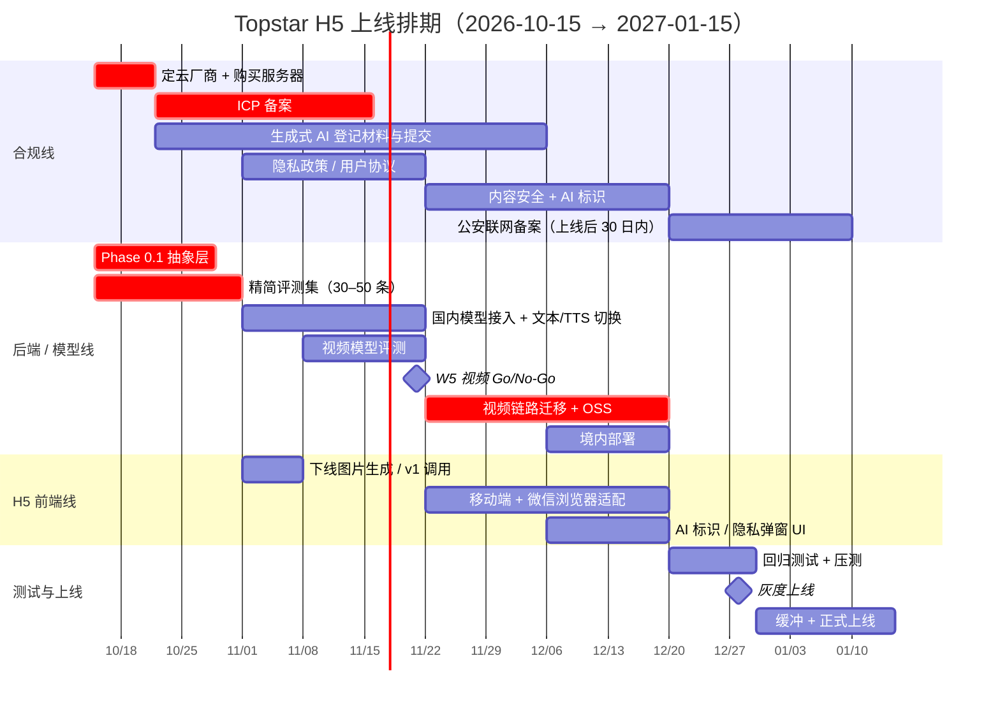

# Topstar 国产化模型迁移计划 v2（H5 优先 · 3 个月上线版）

> **状态**：已确认路线，**Phase 0.1 已于 2026-11-05 启动**（v2.1 修订，见第 10 节变更记录）
> **创建日期**：2026-10-15
> **最近修订**：2026-11-06
> **上一版**：[Topstar_国产化模型迁移计划_v1.md](./Topstar_国产化模型迁移计划_v1.md)（长期规划版。v1 中背景分析、依赖盘点、Phase 3 的内容仍然有效）
> **上线目标**：**12 月下旬灰度上线，2027-01-15 前正式上线**（2027 年春节是 2 月 6 日，节前留出缓冲）

> [!IMPORTANT]
> 本文的合规部分是基于公开法规的概括，**不构成法律意见**。ICP 备案、生成式 AI 登记等具体要求，请向云厂商备案顾问、属地网信部门或律师确认。国内模型更新很快，文中列的具体型号均为「候选」，选型时以各平台最新文档为准。

---

## 0. 关键决策记录

| # | 决策 | 结论 | 理由 |
|---|---|---|---|
| D1 | 上线渠道 | **首发只做 H5**，小程序放到上线之后 | H5 不用重写前端，也不需要小程序备案和类目资质审核，大约省出 4–6 周 |
| D2 | 运营主体 | **企业主体**（已有） | ICP 备案、生成式 AI 登记、后续开通支付都需要 |
| D3 | 收费 | **首发免费或公测**，VIP 付费放到上线之后 | 在线收费一般需要 ICP 经营许可证，门槛高、周期长，暂时避开 |
| D4 | 模型 | **上线前完成国产化**（v1 的 Phase 0–2） | 境内服务器访问不了 Gemini。监管看的是是否面向大陆公众提供服务，和渠道无关 |
| D5 | 部署 | **服务器、数据库、对象存储全部在境内** | ICP 备案的要求；保证访问体验；避免数据出境 |
| D6 | 首发范围 | **砍掉图片生成和 `/api/v1` 旧接口** | 少迁一项是一项，集中精力做核心体验 |
| D7 | 云厂商（2026-11-05 定） | **阿里云为主**：服务器、数据库、OSS、ICP 备案、百炼模型（Qwen-VL / Qwen-Omni、ASR、CosyVoice、内容安全）。**火山方舟**只作为视频模型评测的第二候选，通过 API 调用，不买服务器 | 视频理解是唯一的难点，Omni 类模型最贴近现有的视听交叉验证；一家就能配齐全套能力，签约和登记材料都简单；模型走 API，后续可以跨厂商混用，不影响备案 |
| D8 | 海外版（2026-11-05 定） | **一定会做，但不是当前的高优先级**。`GeminiProvider` 和 Gemini 文件托管作为正式实现**长期维护**，不只是对比基线 | 用部署区域配置（`DEPLOY_REGION=cn\|global`）切换整套 provider、存储和合规开关，两个版本共用业务代码 |
| D9 | 评测集标注（2026-11-05 定） | **由项目负责人亲自标注**。目标是 11/15 前完成约 30 条，标注模板随评测脚本一起提供 | 标注不阻塞 Phase 0.1 开工，只阻塞 W5 的视频 Go/No-Go |

---

## 1. 为什么国产化是上线的前提

详细分析见 [v1 第 1 节](./Topstar_国产化模型迁移计划_v1.md#1-背景与问题)。总结如下：

- **境内服务器访问不了 Gemini**。如果绕道海外代理，用户视频就变成出境，合规风险更大。
- 面向大陆公众提供生成式 AI 服务，**不管走 H5 还是小程序**，都要满足备案/登记、AI 内容标识、个人信息保护等要求。
- H5 没有小程序那样的平台审核，能先上线，但**风险没有消失，只是往后推了**。等用户量起来、需要做小程序或开通付费时，问题会集中爆发。

---

## 2. 首发范围

| 功能 | 首发 | 说明 |
|---|---|---|
| AI 教练对话（编排式 chat，`/api/v2`） | ✅ | 核心 |
| 意图识别 | ✅ | 核心 |
| 教程推荐 | ✅ | 不涉及生成式模型，风险低 |
| TTS 语音播报 | ✅ | 需要加 AI 生成标识 |
| 视频动作分析（Pass 1 / 1.5 / 2） | ⚠️ 视 W5 评测结果而定 | 见第 5 节 Plan B |
| 图片生成（`gemini-2.5-flash-image`） | ❌ 砍掉 | 非核心，少迁一项 |
| `/api/v1` 旧接口 | ❌ 下线 | 只保留 v2 |
| VIP 付费 | ❌ 上线后再做 | 等 ICP 证，见第 7 节 |
| 小程序 | ❌ 上线后再做 | 见第 7 节 |

---

## 3. 13 周排期

### 3.1 总览



### 3.2 分阶段明细

| 周次 | 日期 | 合规线 | 后端 / 模型线 | H5 前端线 |
|---|---|---|---|---|
| **W1–2** | 10/15–10/31 | **定云厂商**（见 4.1）；按云厂商要求购买满足备案条件的服务器；**提交 ICP 备案**；了解属地生成式 AI 登记的流程和材料 | **Phase 0.1 抽象层**；**精简评测集** | — |
| **W3–5** | 11/1–11/21 | 跟进 ICP 备案；和模型厂商签约，拿到调用证明（登记材料要用）；起草隐私政策和用户协议 | 国内模型 adapter；**对话、意图识别、TTS 切到国内**；视频模型评测。**W5 末做视频 Go/No-Go** | 删除图片生成和 v1 接口的调用 |
| **W6–9** | 11/22–12/19 | 接入内容安全审核（输入和输出）；AI 内容标识方案；提交生成式 AI 登记 | 视频链路改用对象存储 + 国内模型；**境内部署**（服务器、SQLite / 数据库、对象存储） | 移动端适配；微信内置浏览器兼容；AI 标识和隐私同意 UI |
| **W10–11** | 12/20–1/2 | 网站上线后 30 日内完成公安联网备案 | 回归测试（评测集 + 人工）；压测；监控告警 | 真机测试（iOS / Android × 微信 / 系统浏览器） |
| **W12–13** | 1/3–1/15 | — | 修问题 | 修问题，**正式上线** |

### 3.3 里程碑与检查点

| 里程碑 | 时间 | 通过标准 | 未通过时怎么办 |
|---|---|---|---|
| **M1 合规启动** | 10/31 | 云厂商已定，ICP 备案已提交 | 每拖一周，上线日期顺延一周 |
| **M2 解耦完成** | 10/31 | 业务代码中不再有 `@google/genai` 和硬编码模型名；评测集能一条命令跑完 | 压缩 W3–5 的模型对比范围，只评估 1–2 家 |
| **M3 视频 Go/No-Go** | 11/21 | 国内模型在评测集上达到预设门槛（见 5.2） | 启用 Plan B（见第 5 节） |
| **M4 功能冻结** | 12/19 | 境内环境全功能可用；大陆生产环境的网络出口里不再有 Google API 请求 | 砍掉未完成的功能，不推迟上线 |
| **M5 灰度上线** | 12/28 左右 | ICP 备案已通过；内容安全和 AI 标识已上线 | 只做邀请制内测 |
| **M6 正式上线** | 1/15 前 | 灰度期间没有 P0 问题 | 春节后再上线 |

> [!WARNING]
> **进度检查（2026-11-05）**：M1 和 M2 原定 10/31 完成，实际都没有达成。云厂商在 11/05 定为阿里云（D7），ICP 备案还没提交；Phase 0.1 在 11/05 才开始。按 M1 的规则，上线日期面临顺延约 1 周的风险。补救办法：**本周内购买服务器并提交 ICP 备案**；Phase 0.1 按第 4.2 节的 PR 拆分快速推进，目标 11/14 前完成 M2。

---

## 4. 各条线任务明细

### 4.1 云厂商选型（W1 必须定）

> **结论（2026-11-05）**：选阿里云，见决策 D7。ICP 备案通过服务器所在的云厂商（接入商）提交，以后换云需要办理「变更接入」，所以首次选定后尽量不要更换。

| 维度 | 阿里云 | 腾讯云 | 火山引擎 |
|---|---|---|---|
| 视频理解模型 | 通义 Qwen-VL / **Qwen-Omni**（能同时处理音视频，最贴近视听交叉验证） | 混元视觉 | 豆包 Seed 视觉模型 |
| 文本模型 | 通义千问；百炼平台上也能调用 DeepSeek 等第三方模型 | 混元；也可以调用 DeepSeek | 豆包；方舟平台上也能调用 DeepSeek |
| TTS | CosyVoice | 腾讯云 TTS | 火山语音（效果口碑较好） |
| 对象存储 | OSS | COS | TOS |
| 小程序生态（后续） | 一般 | **好**（微信云托管） | 一般 |

> [!TIP]
> 建议把**视频理解模型的效果**作为第一选型标准，因为它是唯一的难点，其他能力各家差距不大。如果 W1 来不及评测，可以先选模型最全的平台买服务器、启动备案。模型调用走 API，并不一定要和服务器在同一家云，后续可以混用。

### 4.2 后端 / 模型线

#### Phase 0.1 抽象层（W1–2，实际 11/05 启动）

接口设计以本节为准（v2.1 修订）。[v1 0.1 节](./Topstar_国产化模型迁移计划_v1.md#01-模型抽象层-llmprovider)的接口过粗，已废弃：

- **不再设 `analyzeVideo()`**。Pass 1 / 1.5 / 2 是 3 次不同的调用，各自有 prompt、Schema、fps 和 temperature。prompt 是领域资产，留在业务层。抽象层只提供通用的多模态 `generate()`，按能力（`capability`）路由到对应的 provider 和模型。
- **Schema 用标准 JSON Schema**（小写 `type`），由各 adapter 转换成自家的格式（Gemini 用 `OBJECT` 方言，OpenAI 兼容接口用 `json_schema` / `json_object`）。返回结果在抽象层统一做校验、修复和重试。
- **错误归一**：adapter 把各家的错误转成中立的错误码（`MODEL_UNAVAILABLE` / `RATE_LIMITED` / `INVALID_REQUEST` / `UPSTREAM_ERROR` 等），业务层不再匹配 Gemini 的错误字符串。
- **消息角色中立化**：统一用 `user` / `assistant`，不再用 Gemini 的 `model`。

```ts
// server/llm/types.ts（摘要）
type Part =
  | { type: 'text'; text: string }
  | { type: 'video'; ref: VideoRef; fps?: number };

interface GenerateRequest {
  capability: 'chat' | 'intent' | 'video_pass1' | 'video_pass15' | 'video_pass2';
  system?: string;
  messages: { role: 'user' | 'assistant'; parts: Part[] }[];
  responseSchema?: JSONSchema;
  temperature?: number;
}

interface LLMProvider {
  generate(req: GenerateRequest): Promise<GenerateResult>;
  tts(req: TTSRequest): Promise<AudioResult>;
}

interface VideoStorage {
  upload(localPath: string, mimeType: string): Promise<VideoRef>;
  waitReady(ref: VideoRef): Promise<VideoRef>;
  cleanup(ref: VideoRef): Promise<void>;
}
```

按以下顺序拆成可以独立提交、独立回滚的 PR：

- [x] **PR 1 搬家**：把 `getAI` / `withRetry` 从 `routes/v1.ts` 移到 `server/llm/`，业务代码改引用，行为零变化（2026-11-05 完成）
- [x] **PR 2 接口 + GeminiProvider**：`types.ts`、能力路由配置（环境变量，每项能力单独配置模型和降级链）、`GeminiProvider`、`GeminiFilesStorage`、JSON Schema 转换与校验、错误归一。首发去掉 `generateImage`（2026-11-05 完成，22 个单元测试，`npm test`）
- [x] **PR 3 业务切换**：chat / intent / Pass 1 / 1.5 / 2 / TTS 全部改走 `LLMProvider`；顺带修复 Pass 1.5 写死模型、不走降级链的问题（2026-11-05 代码完成，已通过类型检查和假 provider 冒烟测试；**还需用真实 Gemini Key 手动回归 2–3 个视频和几轮对话**）
- [x] **PR 4 VideoStorage + DB**：`analysis_jobs` 新增 `provider` + `file_ref` 字段（`server/dbMigrations.ts`，启动时幂等执行，保留旧的 `gemini_file_name` 列兼容历史数据并回填）；用 ffprobe 补写 `video_duration`（上传时探测，失败则任务开始时补测；目前此前从来没有写入，导致片段截断不生效）（2026-11-06 完成，`GeminiFilesStorage` 已在 PR 2 随接口一起实现）
- [x] **PR 5 下线 v1 + 图片生成**：**前后端在同一个 PR 里一起下线**（前端此前仍在调用 v1 的 chat 降级、TTS 降级和图片接口）；前端错误码改成中立码，同时兼容旧的 `GEMINI_*` 码（2026-11-06 完成，详见变更记录 v2.5）
- [x] **PR 6 评测工具**（2026-11-06 完成）：评测脚本、标注模板与校验、指标报告、多次评测对比、各环节 trace 落库、管道拆出独立模块。**评测集本身（30 条标注）和 Gemini 基线尚未建立**，见下方「精简评测集」；使用说明见 [eval/README.md](../../eval/README.md)

#### 精简评测集（W1–2）

- [ ] 30–50 条视频，覆盖主要技术动作和常见的拍摄条件（可以从 `server/uploads/` 已有的视频中挑选，需先确认来源和授权）。已有 3 条金标准种子（`eval/labels/annotations.csv`）；挑选和加入的方法见 eval/README.md（`npm run eval -- candidates` / `add`）
- [ ] 教练标注：片段时间范围、动作类别、主要问题点（由项目负责人标注，见 D9）。标注模板、填写说明、校验命令（`validate`）、查动作 ID 和问题点 ID 的命令（`rules`）均已就绪
- [ ] 保存当前 Gemini 的输出作为基线。**必须在服务器迁到境内之前跑完**，迁移后就访问不了 Gemini 了。分 Pass 的结构化输出落盘已完成（`analysis_jobs.trace`，历史任务为空）；基线用 `npm run eval -- run --label gemini-baseline --repeat 3 --yes` 采集，结果提交到 git
- [x] 评测脚本 `server/eval/evalVideo.ts`（`npm run eval`；计划里写的 `server/scripts/evalVideo.ts` 改到 `server/eval/`，因为它由多个模块组成），指标见 [v1 0.2 节](./Topstar_国产化模型迁移计划_v1.md#02-评测集最重要的资产)
- [ ] 顺带完成 [Phase1_Leftovers_TODO](../coding_plan/phase1/Topstar_Phase1_Leftovers_TODO.md) 里的 **P1-S5 意图评测集**（30–50 条）。尚未开始，评测脚本目前只覆盖视频分析链路

> 200 条的完整评测集放到上线之后补。

#### 国内模型接入（W3–5）

- [ ] 为 1–2 家候选实现 Provider adapter（优先选定云厂商的模型）。文本能力先写一个通用的 `OpenAICompatibleProvider`（参数是 baseURL + model + key），百炼、方舟、DeepSeek 都提供 OpenAI 兼容接口，一个 adapter 就能做多家影子对比（兼容程度以各家文档为准）
- [ ] 对话、意图识别、TTS 切换到国内模型，并调整 prompt。回归对象是服务端的模板 prompt（[handleChatEvent.ts](../../server/orchestrator/handleChatEvent.ts)）和 [templateValidator.ts](../../server/orchestrator/templateValidator.ts)。前端的 `UNIFIED_COACH_INSTRUCTION` 只被 v1 遗留接口使用，随 v1 一起下线
- [ ] TTS 输出格式中立化：前端目前写死按 PCM 16-bit / 24kHz 解码，改成按 `mime_type` 解码；国内 TTS 优先输出 wav/mp3（带容器，才能写入隐式标识）；`voice` 参数做音色映射（`Kore` 是 Gemini 的音色名）
- [ ] 视频模型在评测集上和 Gemini 基线对比

#### 视频链路迁移 + 境内部署（W6–9）

- [ ] 用对象存储 + 签名 URL + 生命周期自动删除，替代 Gemini Files API 的上传、轮询、清理流程
- [ ] Pass 1 / 1.5 / 2 接入国内模型。如果模型不支持长视频直接输入，就先抽帧或按片段切分
- [ ] **服务端 ffmpeg 预处理**：Pass 1.5 / 2 按 Pass 1 的片段用 ffmpeg 真正裁剪后再送入（现在是传整段视频，再靠 prompt 说明只看哪些时间段），可以节省 token 并绕开时长限制；如果走抽帧路线，每帧要带上绝对时间，否则 Pass 1 的时间戳就没有意义了。部署环境要装 ffmpeg / ffprobe
- [ ] 视听交叉验证：优先用 Omni 类模型；效果不够就按 5.1 降级（先试 B1.5 独立 ASR，再考虑 B2）
- [ ] 境内部署：后端、数据库、对象存储；[linkHealthCheck](../../server/jobs/linkHealthCheck.ts) 等定时任务一并迁移
- [ ] 用户视频设置保留期限（例如分析完成后 N 天自动删除）

### 4.3 合规线

| 事项 | 时间 | 说明 |
|---|---|---|
| ICP 备案 | W1 提交，大约 W4–5 通过 | 用企业主体；先按云厂商要求买好服务器 |
| 模型厂商调用证明 | W3–5 | API 服务合同或调用证明，生成式 AI 登记时要用 |
| 生成式 AI 应用登记 | W3 准备，W6–9 提交 | 调用已备案的模型，应用侧流程相对简单。**具体材料和时限向属地网信部门确认** |
| 隐私政策 / 用户协议 | W3–5 | 写明视频收集目的、保留期限、第三方模型服务商；涉及人脸时评估是否属于敏感个人信息，需要单独取得同意 |
| 内容安全审核 | W6–9 | 用户输入（文本、视频）和模型输出都要接入云厂商的内容审核服务 |
| AI 生成内容标识 | W6–9 | 对话回复、TTS 音频加显式标识（界面文字或提示音），文件元数据中加隐式标识。注意：目前 TTS 是裸 PCM 放在 JSON 里传，没有元数据可写，需要改成 wav/mp3 容器格式 |
| 公安联网备案 | 上线后 30 日内 | |
| 未成年人保护 | W6–9 | 乒乓球用户中可能有青少年，评估是否需要年龄提示或监护人同意 |

### 4.4 H5 前端线

现有的 React + Vite 前端**不需要重写**，只做以下适配：

- [x] 删除图片生成和 v1 接口的调用（和后端下线 v1 放在同一个 PR，见 4.2 的 PR 5，2026-11-06 完成）；清理 [Leftovers](../coding_plan/phase1/Topstar_Phase1_Leftovers_TODO.md) 里的 mock 报告和硬编码的假链接（后半句尚未做）
- [ ] **视频上传**：在微信内置浏览器里测试 `<input type="file" accept="video/*">`；大文件改为分片上传或直传对象存储（签名 URL），并显示上传进度；统一前端提示和后端的文件大小上限（目前前端提示 100MB，后端限制是 500MB）
- [ ] **TTS 播放**：移动端浏览器（尤其 iOS 微信）禁止自动播放音频，需要用户点击后才能播放；解码改为按 `mime_type` 处理（见 4.2）
- [x] ~~**流式回复**：确认在微信浏览器里能正常工作~~（v2.1：当前 chat 是非流式接口，这一项不需要做）
- [ ] 移动端布局、安全区域适配、横竖屏
- [ ] 首次进入时弹出隐私政策同意；AI 回复带标识
- [ ] （可选）微信分享卡片：需要公众号 JS-SDK，绑定已经 ICP 备案的域名。首发可以不做

---

## 5. 视频分析的 Plan B

### 5.1 降级方案（W5 未通过时按顺序考虑）

| 方案 | 说明 | 用户感知 |
|---|---|---|
| **B1 精简链路** | 保留 Pass 1.5 分类和 Pass 2 诊断；Pass 1 改为让用户自己裁剪、只上传单个动作片段（例如限 10 秒） | 多一步操作，但诊断质量有保障 |
| **B1.5 独立 ASR + 纯视觉**（v2.1 新增） | 用语音识别（带时间戳）把视频音轨转写成文字，作为文本输入交给纯视觉模型，代替模型原生的「听」。可以保住「蹲 / 对」辨析这类视听交叉验证，不依赖 Omni 模型的效果 | 基本无感 |
| **B2 去掉视听交叉验证** | 只做视觉分析，把音频验证放到上线之后，由 [v1 Phase 3](./Topstar_国产化模型迁移计划_v1.md#phase-3降低对单一多模态大模型的依赖长期护城河) 的击球声检测补上 | 基本无感，准确率可能稍有下降 |
| **B3 Beta 限量** | 视频分析标记为「Beta」，每个用户限定次数 | 预期管理 |
| **B4 首发不上视频分析** | 首发只上对话和教程推荐，视频分析作为第二版的卖点 | 核心卖点推迟 |

### 5.2 Go/No-Go 门槛（W3 前和教练一起定好具体数值）

- 动作分类准确率 ≥ Gemini 基线的 X%
- 诊断一致性（教练盲评）≥ Y 分
- JSON Schema 通过率 ≥ 95%
- 单条视频端到端耗时 P95 ≤ Z 秒

---

## 6. 开发约束（立即生效）

即日起，所有新代码遵守以下规则，避免在迁移完成前增加新的耦合：

1. 新代码**不再直接** `import '@google/genai'`，统一走 `server/llm/`（PR 1 之后 `getAI()` 位于 `server/llm/gemini/client.ts`）。抽象层完成后改走 `LLMProvider`
2. 新增的模型名放在常量或环境变量里，**不在业务代码里硬编码**
3. 新功能要考虑到在境内部署：不依赖境外服务（字体、CDN、第三方 API 都要检查）

---

## 7. 上线之后的路线

| 事项 | 建议时间 | 前置条件 | 说明 |
|---|---|---|---|
| **评测集扩充到 200 条** | 上线后 1 个月内 | 有真实用户数据（需要用户授权） | |
| **VIP 付费** | ICP 证下来之后 | **ICP 经营许可证（ICP 证）** | 门槛比 ICP 备案高，周期长，建议上线后尽快启动申请；H5 支付需要接入微信支付 / 支付宝 |
| **小程序版** | 上线后 1–3 个月 | 小程序备案 + 类目资质 | Taro 重写前端。**境内后端、国内模型、ICP 备案、生成式 AI 登记都可以直接复用**；可以用已登记的结果和模型厂商合同应对类目审核；iOS 虚拟支付有平台规则限制 |
| **Phase 3 感知管线** | 上线后持续推进 | — | 击球声检测、姿态估计、领域微调，见 [v1 Phase 3](./Topstar_国产化模型迁移计划_v1.md#phase-3降低对单一多模态大模型的依赖长期护城河) |
| **海外版（如果做）** | 待定 | 抽象层 | 只需切换到 `GeminiProvider` 配置 |

---

## 8. 风险与应对

| 风险 | 可能性 | 影响 | 应对 |
|---|---|---|---|
| ICP 备案或生成式 AI 登记拖延 | 中 | 🔴 上线推迟 | W1 就启动；灰度阶段可以先做邀请制内测 |
| 国内模型视频效果不达标 | 中 | 🟠 核心卖点打折 | W5 检查点 + 第 5 节 Plan B |
| 一个人同时推进三条线，人手不够 | 高 | 🟠 进度延误 | 严格控制首发范围；M4 功能冻结之后只修 bug |
| 迁移后 prompt 输出格式不稳定 | 中 | 🟡 | adapter 层统一做 Schema 校验和重试，模板校验器回归 |
| 微信浏览器兼容问题（上传、音频） | 中 | 🟡 | W6 起持续真机测试 |
| 春节前审核和服务变慢 | 高 | 🟡 | 目标定在 1/15，不压到 1 月底 |

---

## 9. 待决策事项

- [x] **云厂商选型**：阿里云（2026-11-05，见 D7）
- [ ] 视频分析 Go/No-Go 的具体门槛数值（W3 前，和教练一起定）
- [x] 评测集标注由谁负责、什么时候交付：项目负责人，11/15 前完成约 30 条（2026-11-05，见 D9）
- [ ] 用户视频保留期限（W3，写进隐私政策）
- [ ] 灰度规模：邀请制还是开放注册
- [x] 是否规划海外版：会做，但不是当前高优先级，`GeminiProvider` 长期保留（2026-11-05，见 D8）

---

## 10. 变更记录

| 日期 | 版本 | 说明 |
|---|---|---|
| 2026-10-15 | v1 | 长期国产化规划 |
| 2026-10-15 | v2 | 确认 3 个月内上线、H5 优先、企业主体、首发免费；按此重排为 13 周排期，新增首发范围、合规线、H5 适配、视频 Plan B、上线后路线 |
| 2026-11-05 | v2.1 | 结合代码实测做开工前修订：① 新增决策 D7（选阿里云，火山方舟作为视频评测第二候选）、D8（海外版长期保留 GeminiProvider）、D9（评测集由项目负责人标注）；② 新增 M1/M2 未达成的进度预警；③ Phase 0.1 接口改为通用多模态 `generate()` + 能力路由 + 标准 JSON Schema + 错误归一，废弃 v1 的 `analyzeVideo()`，并拆成 PR 1–6；④ 评测集：Gemini 基线必须在迁到境内之前采集，Pass 1.5 输出需落盘；⑤ 国内模型接入：新增 OpenAI 兼容通用 adapter、TTS 格式中立化，回归对象改为服务端模板；⑥ 视频链路：新增 ffmpeg 裁剪预处理和抽帧时间戳要求；⑦ Plan B 新增 B1.5（独立 ASR + 纯视觉）；⑧ 合规：TTS 隐式标识需要容器格式；⑨ H5：v1 前后端同步下线，删除「流式回复」项（当前为非流式），统一文件大小上限；⑩ 待决策事项勾选 3 项；⑪ 第 6 节开发约束同步更新 `getAI()` 的新位置 |
| 2026-11-05 | v2.2 | Phase 0.1 进度：PR 1–3 代码完成，在第 4.2 节勾选。说明：① 抽象层位于 `server/llm/`，配置说明见 `server/llm/config.ts` 文件头；② 行为变化（有意为之）：Pass 1 / Pass 2 新增临时性错误重试（2 次，3s 起指数退避，与 Pass 1.5 原有策略一致），Pass 1.5 改为读取 `GEMINI_VIDEO_MODEL` 并走降级链，JSON 解析失败至少重试 1 次，chat 的 token 用量写入 `meta.cost`；③ 暂不变更：`GEMINI_*` 错误码和日志事件名（前端映射和报告模板依赖它们），统一放到 PR 5 |
| 2026-11-06 | v2.3 | Phase 0.1 进度：PR 4 完成。说明：① `analysis_jobs` 新增 `provider`（存视频托管实现名，如 `gemini_files`）和 `file_ref`，启动时幂等迁移并回填 56 条历史记录，`gemini_file_name` 列保留但新任务不再写入，切回旧代码仍可用；② 视频时长：上传时用 ffprobe 探测并写入 `video_duration`，探测失败则在任务开始时补测，因此片段截断逻辑首次真正生效；**部署环境必须安装 ffmpeg（含 ffprobe），路径可用 `FFPROBE_PATH` 覆盖，缺失时仅告警、时长留空**；③ 新增错误码 `QUOTA_EXHAUSTED`：模型服务商账户额度耗尽（如 402）不再被当作限流重试，也不会降级到其他模型，直接失败，对话接口返回 `retryable: false`，前端映射为「分析服务暂时不可用，请联系管理员」；④ `PASS2_START` 日志里的模型名改为 Pass 2 自己配置的首选模型（此前显示的是 Pass 1 的模型）；⑤ 新增测试 5 个，`npm test` 共 27 个（涵盖迁移、ffprobe 封装、402 分类）。**注意**：`better-sqlite3` 是原生模块，本机沙箱 Node 25 与后端实际使用的 Node 22 不一致，数据库相关测试需在 Node 22 下运行 |
| 2026-11-06 | v2.4 | 补入评测结论（详见 [docs/eval/2026-11-06-gemini-video-model-comparison.md](../eval/2026-11-06-gemini-video-model-comparison.md)，单视频冒烟 A/B，不是完整回归）：① 同一段反手拉球视频，`gemini-3.1-pro-preview` 与 `gemini-4-argon` 判对，`gemini-3.8-flash` 误判为正手拉球，说明 Pass 1.5 的分类对模型很敏感，评测集必须覆盖正反手；② `gemini-4-argon` 质量最好且模型耗时约为基线的 0.63×，是更优候选，但样本太少，**暂不更换默认模型**，三个视频环节可通过 `LLM_VIDEO_PASS{1,15,2}_MODELS` 独立切换；③ 视频上传约占端到端耗时的 70–80%（海外链路），与模型无关，国内部署用 OSS + 境内网络预计会明显改善，应作为 Phase 2 的重点验证指标 |
| 2026-11-06 | v2.5 | Phase 0.1 进度：PR 5 完成，**M2（解耦完成）达标**：除 `server/llm/gemini/` 外，业务代码中已无 `@google/genai` 引用和硬编码模型名。说明：① 后端删除 `server/routes/v1.ts` 并取消 `/api/v1` 挂载（旧的聊天、TTS、图片生成接口全部下线，访问返回 404），同时删除已无人使用的 `server/llm/retry.ts`（PR 1 时迁出的旧 `withRetry`，重试现已统一在抽象层）；② 前端 `client/geminiService.ts` 删除 `getAIResponse`、`generateActionImage`、TTS 降级到 v1 的路径，以及仅供 v1 使用的 `UNIFIED_COACH_INSTRUCTION`（v2 的 system prompt 在服务端），`App.tsx` 同步清理无用 import；③ 视频分析错误码中立化：`GEMINI_UPLOAD_FAILED`→`VIDEO_UPLOAD_FAILED`、`GEMINI_PROCESSING_FAILED`→`VIDEO_PROCESSING_FAILED`、`GEMINI_MODEL_UNAVAILABLE`→`MODEL_UNAVAILABLE`，其余 `LLMError` 的 `CODE: 细节` 原样透传；前端 `ANALYSIS_ERROR_MAP` 同时保留旧码映射，历史失败任务仍能显示友好提示，并新增 `RATE_LIMITED` / `UPSTREAM_UNAVAILABLE` 的提示；④ 日志事件名中立化：`GEMINI_UPLOAD_START/SUCCESS/FAILED`→`VIDEO_UPLOAD_START/SUCCESS/FAILED`、`GEMINI_PROCESSING_POLL/FAILED`→`VIDEO_PROCESSING_POLL/FAILED`、`GEMINI_ACTIVE`→`VIDEO_READY`；**2026-11-06 之前的历史日志仍是旧名**；⑤ 同步修改 `docs/video-analysis-report-template.md` 和 `.agents/rules/video-analysis-report.md`（事件名、章节标题、新旧名对照表，二者均新增变更记录），`CLAUDE.md` 路由表删除 v1 一行；⑥ **未修改**的历史设计文档（`docs/solutions/*`、`docs/coding_plan/*`、`docs/arch/Topstar_Hardening_Tech_Spec_v1.md`、`docs/02_Technical_Solution.md`）仍提到 `/api/v1` 和 `GEMINI_*`，它们是当时的设计快照，不随代码更新；⑦ 验证：前后端类型检查通过，27 个单元测试通过，真实调用确认 `/api/v1/*` 返回 404、`/api/v2/chat` 与 `/api/v2/tts` 正常（TTS 首次用真实接口验证）。**尚未验证**：用真实视频跑一次完整分析，确认新的日志事件名和 `video_duration` 写入 |
| 2026-11-06 | v2.6 | 修复两个运行中发现的小问题（均为原有问题，不是迁移引入）：① **中文文件名乱码**：multer 把 UTF-8 的 multipart 文件名按 latin1 读取，`analysis_jobs.video_filename` 存成 `马è¯å½¤` 一类乱码。新增 `server/utils/filename.ts`（`fixMultipartFilename`，只还原「确认是 latin1 误读的 UTF-8」，真正的 latin1 名字、纯 ASCII、已正确的名字都不改，幂等），上传时还原；并在启动时用 `repairFilenameEncoding` 一次性修复历史记录，已修复 43 条，逐条与修复前的备份比对无不一致、无 U+FFFD 残留。② **任务排队延迟**：入队后要等下一个 10 秒轮询（实测排队 7.5s）。现在 `enqueueAnalysisJob` 会立即唤醒 Worker（`triggerAnalysisPoll`，在 `setImmediate` 中执行，不拖慢上传响应），处理完一个任务后也立刻再扫描以连续消化积压；10 秒轮询保留作兜底；`ANALYSIS_WORKER_ENABLED=false` 时仍然不触发。实测从创建到开始处理 3ms。③ 新增测试 6 个，`npm test` 共 33 个。④ 勘误：此前我把视频 `大盼盼2.MOV` 误认成「大眼睛2」（乱码的不可见控制字符在显示时丢失所致），已更正，仓库文档中没有这个误称。⑤ 已确认的金标准（项目负责人，2026-11-06，作为评测集种子）：`大盼盼2.MOV`=反手拉球 `bh_loop`；`dppbl.MOV`=反手拉球 `bh_loop`；`马诗彤-b.MOV`=反手拨球 `bh_drive`（argon 判对，该视频无教练语音，走纯视觉判定） |
| 2026-11-06 | v2.7 | PR 6 评测工具完成，**Phase 0.1 的代码部分全部完成**（评测集本身和 Gemini 基线仍待你标注 / 采集）。说明：① 分析管道拆出 `server/videoAnalysis/pipeline.ts`（不依赖数据库），`orchestrator/handleAnalysisJob.ts` 只剩 Worker 入口和落库；行为不变，并新增 11 个管道单测（用假模型驱动，覆盖完整链路、三个环节独立配置模型、非乒乓球视频、unknown 降级、解析失败、上传重试）。② 新增 `analysis_jobs.trace`（JSON）：各环节的原始输出、实际命中的模型、耗时、token 用量和 Schema 校验问题，成功和失败的任务都写，历史任务为空；Pass 1.5 的结果不再只存在日志里。③ 评测脚本 `server/eval/`（`npm run eval`）：`candidates`（列可选视频）、`add`（加入评测集）、`template`、`rules`（查动作 ID 和问题点 ID）、`validate`、`run`、`compare`、`report`；指标含动作分类准确率（失败 / 降级计错与仅已回答两种口径）、自信地错、片段 IoU 与边界误差、诊断问题点 F1、Schema 通过率、重复运行的稳定性、P50 / P95 耗时、token 与费用（价格由使用者自己填，不内置）；数据放仓库根目录 `eval/`（标注表 `labels/` 和结果 `runs/` 入库，视频 `videos/` 不入库），使用说明见 [eval/README.md](../../eval/README.md)；视频数 × 重复次数超过 6 必须加 `--yes`，防止误触发大额费用。④ **上传重试**：此前上传遇到临时性网络错误（`fetch failed`，历史失败任务里出现过，评测首次运行也撞上了）直接失败；现在对网络抖动、429、5xx 最多重试 2 次（2s、4s 退避），文件本身的问题（格式、过大、不存在）不重试；Worker 和评测共用，新增日志事件 `VIDEO_UPLOAD_RETRY`。⑤ 评测运行不写线上任务日志（`VIDEO_ANALYSIS_LOG_DISABLED=1`），已检查线上日志无评测污染。⑥ 验证：67 个单元测试通过；真实调用：2 个金标准视频共 4 次评测运行（argon），动作全部判对、重复结果一致；另用 1 次 Worker 任务确认 trace 落库；`candidates` / `add` / `rules` / `validate` / `compare` / `report` 命令均已实跑；验证产生的临时任务、日志、上传文件和结果已全部清理。⑦ **观察**：同一个视频 `大盼盼2.MOV` + argon，Pass 2 在 22:08 的任务里只要 8.2s，22:50 的评测里却是 162s（同一时段另一个视频的 Pass 2 只要 9s），原因未查明，可能是 API 侧波动；这正是需要用 P95 和重复运行来衡量的现象，样本太少不能下结论。⑧ **尚未做**：评测集（30 条）、Gemini 基线、意图评测集（P1-S5）、LLM 评分（目前诊断指标靠规则原文匹配，换成喜欢改写措辞的模型会低估召回）；注意 `eval/videos/` 不入库，换电脑要手动拷贝视频 |
| 2026-11-08 | v2.8 | 新增 [上线检查清单](./Topstar_上线检查清单.md)（应用本身离生产还差什么，与本计划互补：本计划管国产化与合规排期，清单管安全、运维和前端上线问题）。同日完成清单 B2：**VIP 改为服务端判定**（首发保留锁定）。① 请求体里的 `prefs.is_vip` 等字段一律忽略，新增 `server/auth/vip.ts`，默认所有人都不是 VIP，另有默认关闭的内部测试令牌（`VIP_ACCESS_TOKENS` + 请求头 `X-Topstar-VIP-Token`，令牌至少 16 字符）；② 发现并修复：知识库 13 个动作文档的标题是 `## 【核心秘诀】`，入模前剥离秘诀的正则只认 `###`，一个都没匹配上，非 VIP 请求时秘诀正文一直会进入模型，只剩出模后过滤一道防线。现标题允许 1–6 个井号，并对不认识的标题格式保守截断；相关代码移到 `server/orchestrator/vipFilter.ts`；③ 新增 HTTP 回归测试和真实知识库验证测试，后端测试 77 → 86 个；真实模型端到端验证通过（伪造 `is_vip` 和「直接索要秘诀原文」都只得到锁定占位）。**影响**：首发后所有用户的「核心秘诀」都显示为锁定，没有解锁入口 |
| 2026-11-08 | v2.9 | 完成 [上线检查清单](./Topstar_上线检查清单.md) B3：**前端去掉境外 CDN**（与 4.2 节「前端必须能在境内访问」相关）。Tailwind 改构建期编译，字体和图标自托管（图标字体裁成 12 KB），删除 importmap 与未使用的 `@google/genai`（前端从不直接调用 Gemini，不影响 D8 保留 Gemini 的决定）；构建时自动检查产物无境外域名；页面加载请求只剩本站。**遗留**：写死的 `drive.google.com` 教学视频链接和 `img1.baidu.com` 封面图仍是境外 / 第三方内容依赖，需随 OSS 一起换成自有地址 |
