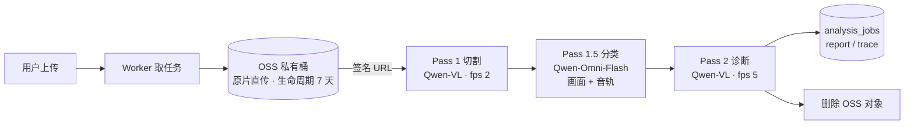

# Topstar 视频链路国产化方案 v1

> **状态**：2026-11-25 评审过三轮并确认开工。**V0 代码、V1 已完成；V1 已在真机跑通整条视频链路**（Qwen 三 Pass 全过，224 个测试通过）。V0 剩下的 Gemini 基线仍被「本机连不上 Google」挡住，V2–V4 未开工。
> **创建日期**：2026-11-25　**最近修订**：2026-11-25
> **承接**：[迁移计划 v2](./Topstar_国产化模型迁移计划_v2.md) 的决策 D7（阿里云为主、方舟为视频第二候选）、D8（海外版长期保留 Gemini）、D9 / D11（评测集只用于选型和回归，不做微调）。v2 §4.2「视频链路迁移」和 §5「Plan B」的落地细节以本文为准。
> **核实口径**：第 1.1 节的到期时间来自 Google 官方 deprecations 页；第 2 节的厂商能力来自 2026-11-25 抓取的官方文档和新闻。国内模型更新很快，**接入前以控制台和当日文档为准**，文中型号都是候选。

## 0. 一页结论

1. **本轮范围：只接百炼。** Pass 1 / Pass 2 用 Qwen-VL，Pass 1.5 用 `qwen3.8-omni-flash`（原生听音轨，对应现在的视听交叉验证）；视频托管换成 OSS 私有桶 + 签名 URL；原片直送模型，不做转码（4.2）。豆包和 ASR 兜底放到后续，接口上留好位置。
2. **现有抽象层够用**：按能力路由、重试、降级、JSON 校验、错误归一都已就位，三个 Pass 的 prompt 和流程不用动。新增 1 个 provider、1 个 storage，配置里补国内默认值。
3. **Gemini 侧的两个到期日已在 V0 处理**（详见 1.1）：视频降级链首选改为 `gemini-4-argon`，移除 12-01 停用的 2.5 系列（改前 Pass 1.5 的兜底会被自动改道成我们自己测出会判错动作的模型）；TTS 默认 provider 改为千问，Gemini TTS 兜底型号换成 `gemini-3.8-flash-tts`（12-18 停用的是 `gemini-2.5-flash-preview-tts`）。**没配 `DASHSCOPE_API_KEY` 的环境，现在朗读会报未配置。**
4. **V0 还剩三件事**：ffprobe（`brew install ffmpeg` 11-25 在后台安装，装完才能写 `video_duration`，此前片段截断从未生效）；评测集只有 3 条标注、本地只有 1 个视频文件；Gemini 基线没采，而且这台机器的 Node 当前连不上 Google。
5. **排期**：视频 Go/No-Go 定在 **12/11（周五）**，12/28 灰度不变，见 6.4。

## 评审决策（2026-11-25）

| # | 事项 | 结论 | 落在哪 |
|---|---|---|---|
| R1 | 云厂商 | 先只接百炼；豆包还没申请，后续再接 | §4.8 保留跨厂商降级链的写法；§2 保留方舟能力对照备查 |
| R2 | Pass 1.5 音频 | 先交给 Omni 原生听音轨；ASR 方案后续再做 | §4.3 保留策略开关；12/02 冒烟不过就把 ASR 提前 |
| R3 | 片段门槛 | 召回 ≥ 0.9、多检不多于基线、平均边界误差 ≤ 2 秒；IoU 只看趋势 | §6.2 |
| R4 | 排期 | 按 6.4 执行 | §6.4 |
| R5 | 影子模式 | 不做。它指线上仍用 Gemini 出结果，同时把同一条视频偷偷跑一遍国内链路、只记录不展示，用来拿真实上传视频做对比。现在还没上线、上传量就是团队自己，价值不够抵 2–3 天开发和双份模型费；等境内部署后 Gemini 不可达，这个对比窗口也就关了 | — |
| R6 | Gemini 降级链 | 按 1.1 修；**首选改为 `gemini-4-argon`**，`3.1-pro-preview` 退到第二顺位（后续测试都以 argon 为首选） | V0 |
| R7 | 转码 | **不做**。原片直送模型；解码失败时给明确的错误码和文案，真遇到再加 | §4.2、V4 |
| R8 | TTS | 代码 11-20 已切到千问（流式 + 缓存），不在本轮范围；只需把代码默认值和各机器的 `.env` 对齐，避免落到 12-18 停用的 Gemini 型号 | §1.1、V0 |

## 1. 现状（代码事实，2026-11-25）

| 环节 | 现状 | 对迁移的影响 |
|---|---|---|
| 抽象层 | `server/llm/` 已完成：按能力路由、模型降级链、临时错误重试、JSON 解析与校验、错误归一 | ✅ 直接复用 |
| 国内默认值 | `CN_DEFAULTS = null`，`DEPLOY_REGION=cn` 时所有能力必须用环境变量显式指定 | 待补 |
| 国内 provider | `dashscope` 只实现了 TTS（`QwenTtsProvider.generate()` 直接抛错）；`deepseek` 不收视频 | 需新增 VL / Omni |
| 视频托管 | `VideoStorageName` 只有 `gemini_files` | 需新增 OSS |
| 降级链 | 一个能力只能配一个 provider，模型列表只能在同厂商内降级 | 现在够用；接豆包时再放开（§4.8） |
| 三个 Pass | Pass 1 / 1.5 / 2 各调一次模型，每次都传**整段视频**（fps 2 / 5 / 5），靠 prompt 告诉模型「只看这几个时间段」 | Gemini 也是这么工作的，不是迁移引入的问题；裁剪是后续优化（§4.4） |
| 时间戳 | prompt 要求 `mm:ss`，`parseTimestamp` 兼容 `hh:mm:ss`；片段有 −3s / +1s 缓冲和 ≤5s 合并 | ✅ 兼容，精度预期见 4.4 |
| 视听交叉验证 | Pass 1.5 依赖模型原生听音轨，输出 `audio_transcript`，再做「蹲 / 对」辨析 | 国产只有 Omni 类模型能原生做到 → **最大风险点** |
| ffprobe | `server/video/probe.ts` 依赖 ffprobe。本机原先未安装，失败时静默返回 undefined；**V0：`brew install ffmpeg` 11-25 后台安装中** | 装完后 `video_duration` 才有值，片段截断才生效；境内服务器部署清单也要加 |
| TTS | **V0 已改**：代码默认 `dashscope / qwen-audio-3.1-tts-flash`（SSE 流式只为它实现）；只设 `LLM_TTS_PROVIDER=gemini` 切回谷歌时，自动用官方替代 `gemini-3.8-flash-tts`。改前默认是 12-18 停用的 `gemini-2.5-flash-preview-tts` | 这台机器的 `server/.env` 没有 `DASHSCOPE_API_KEY`，`npm run verify-llm` 实测 tts 的 key 为 NO，朗读会报未配置（1.1） |
| 评测 | 脚本、trace、标注模板已就绪；标注 3 条（只有 `dppbl` 完整标注）；`eval/videos/` 本地只有 `dppbl.MOV` 一个文件（`server/uploads/` 里 3 个文件大小相同，是同一个视频）；Gemini 基线未采集 | Go/No-Go 的前提 |

### 1.1 Gemini 侧的到期时间与修复方案

来源：[Gemini API deprecations](https://ai.google.dev/gemini-api/docs/deprecations)，2026-11-25 查阅。 **修复已于 11-25 合入代码（V0）**，下表「处理」一列即现状。

| 模型 | 现在的用途 | 官方状态 | 处理 |
|---|---|---|---|
| `gemini-4-argon` | 未使用（11-06 之后只在评测里跑过） | 未公布停用日期（10-13 发布） | **升为首选** |
| `gemini-3.1-pro-preview` | 视频 Pass 1 / 1.5 / 2 首选 | 未公布停用日期 | 退到第二顺位 |
| `gemini-3.8-flash` | 未使用 | 未公布停用日期 | 进 Pass 1 / 2 降级链末位；**不进 Pass 1.5** |
| `gemini-2.5-pro` | 视频 Pass 1 / 1.5 / 2 第二顺位 | **12-01 停用**，请求自动改道到 `gemini-3.8-flash` | 从链里移除 |
| `gemini-2.5-flash` | 第三顺位 | **12-01 停用**，请求自动改道到 `gemini-3.5-flash-lite` | 从链里移除 |
| `gemini-2.5-flash-preview-tts` | 海外版 TTS 默认型号 | **12-18 停用**，官方替代 `gemini-3.8-flash-tts` / `-lite-tts` | 见下 |

**视频降级链**（改动只在 `server/llm/config.ts` 和它的单测）：

```ts
const GEMINI_VIDEO_MODELS        = ['gemini-4-argon', 'gemini-3.1-pro-preview', 'gemini-3.8-flash']; // Pass 1 / Pass 2
const GEMINI_VIDEO_PASS15_MODELS = ['gemini-4-argon', 'gemini-3.1-pro-preview'];                     // Pass 1.5 不放 3.8-flash
```

- **首选 `4-argon`**。后续测试都以它为首选，Gemini 基线也用它采。[测评报告](../eval/2026-11-06-gemini-video-model-comparison.md)里它判断正确、问题点最具体、模型计算耗时 0.63×；11-06 之后 2 个金标准视频 4 次评测运行也都判对、重复一致。它目前只在这 2 个视频上跑过，基线采集本身就是测评报告第 9 节要求的「扩大样本验证」。
- **第二顺位 `3.1-pro-preview`**。唯一经过生产验证的型号，官方未公布停用日期。
- **Pass 1.5 去掉 `3.8-flash`**。测评里它以 0.95 的置信度把反手拉球判成正手，`evaluateClassification` 的 0.75 置信度门槛拦不住这种错；Pass 1.5 判错，后面的诊断和教程推荐全部作废。宁可让任务报「模型暂不可用」，也不要自信地错。Pass 1 / Pass 2 判错的代价小得多，保留 `3.8-flash` 作最后兜底。
- **不修的后果**：12-01 之后链不会报错，而是**静默变成** `3.1-pro → 3.8-flash → 3.5-flash-lite`——Pass 1.5 的兜底正好是判错过的那个型号。
- 降级只在首选 `MODEL_UNAVAILABLE` 时触发，所以这个修改不影响基线采集的模型。

**TTS**：语音播报的代码已经在 11-20 切到千问（提交 `cd03bd0` / `4b675fa` / `571cba8`：`dashscope` provider、SSE 流式、音频缓存），不需要再迁，也不在本轮范围。V0 把配置也对齐了，现状如下：

- ① **已改**：`tts` 的代码默认 provider 改成 `dashscope`。Gemini TTS 留作环境变量可切回的兜底——只设 `LLM_TTS_PROVIDER=gemini` 即可，型号自动用官方替代 `gemini-3.8-flash-tts`，不会把千问的模型名发给 Google（`PROVIDER_DEFAULT_MODELS`）。
- ② **待你补**：每台开发机和服务器都要有 `DASHSCOPE_API_KEY`（`LLM_TTS_PROVIDER` 不用再设）。写方案时这台机器的 `server/.env`（11-18 修改，早于 TTS 切换的提交）没有这个 Key，改完默认值后 `npm run verify-llm` 显示 tts 的 key 为 NO。
- ③ **未验证**：`gemini-3.8-flash-tts` 的真实调用没做成——这台机器的 Node 当前连不上 Google（`curl generativelanguage.googleapis.com` 10 秒超时；系统代理是 PAC 模式，Node 不认）。等代理可用后补一次：`LLM_TTS_PROVIDER=gemini` 下调用一次 `tts`。

## 2. 候选模型能力对照

| 能力 | 百炼 Qwen-VL（`qwen3.8-max` / `qwen3.8-flash` / `qwen3.7-plus` …） | 百炼 Qwen-Omni（`qwen3.8-omni-flash` / `qwen3.5-omni-flash`） | 方舟 豆包 Seed 2.0（**后续**） | Gemini（基线） |
|---|---|---|---|---|
| 视频时长 / 大小 | 2 小时 / 2GB | 3.8：2 小时 / 2GB，单请求最多 64 个视频；3.5：1 小时 / 2GB | URL、Base64 均 **≤ 50MB**；Files API ≤ 512MB（仅 Responses API） | Files API |
| 抽帧 | `fps` 0.1–10，默认 2 | 文档示例没展示 `fps`，**待验证** | `fps` 0.2–**5**；每视频 ≤ 80K token，Seed 2.0 ≤ 1280 帧 | 默认 1 fps，可指定 |
| 音轨 | ❌ 只看画面 | ✅ 视频文件里的音频和画面一起理解，输出文本 | 视频理解文档写明「不理解音频」；2026-05 的 Seed 2.0 lite 升级宣称「全模态」，**待验证** | ✅ |
| 时间戳 | 文档有「事件定位 + HH:mm:ss」示例 | 同左 | 每帧前插入 `[N second]` 文本 | 每秒带时间戳 |
| 结构化输出 | 支持 | 思考 / 非思考模式均支持 JSON Object | `json_object`（待验证） | responseSchema |
| 思考模式 | 部分型号支持 | 3.8 **默认开启**，`enable_thinking` 可关；3.5 也支持开关 | Seed 2.0 支持深度思考 | — |
| 接入 | OpenAI 兼容 `chat/completions`；`video_url` 传公网 URL / Base64（编码后 < 10MB）/ 同账号 OSS | 同左 | OpenAI 兼容；`video_url` 传公网 URL / Base64 | `@google/genai` |
| 容器格式 | MP4、AVI、MKV、MOV、FLV、WMV | 同左 | MP4 / AVI / MOV | MOV 可 |

说明：

- **型号以控制台为准**。百炼文档推荐 `qwen3.8-max`，但兼容接口的示例里已经出现 `qwen4-max`；Base URL 也出现了 `https://{WorkspaceId}.cn-beijing.maas.aliyuncs.com/compatible-mode/v1` 的新写法，老的 `dashscope.aliyuncs.com/compatible-mode/v1` 是否继续可用要确认。→ **Base URL 和型号全部环境变量化**。
- 方舟一列只为以后接入时备查，来自对官方文档的[第三方整理](https://github.com/Quriosity-agent/qcut/blob/master/qcut/docs/technical/volcengine-ark-video-understanding/06-api-reference.md)（源文档 82379/1895586），本轮不评、不接。

## 3. 目标架构（DEPLOY_REGION=cn）



- 海外版（`global`）一行不动：Gemini + Gemini Files（D8）。
- 每个环节的 provider / 模型继续用现有的 `LLM_VIDEO_PASS1 / PASS15 / PASS2_PROVIDER / MODELS` 配置。
- 三个 Pass 仍然各送一次整段视频，和现在 Gemini 的做法一致；本轮不切片段。
- 原片直传，不转码。ffprobe 取时长是现有逻辑，仍在 Worker 里做。

## 4. 关键设计

### 4.1 视频托管：OSS 私有桶 + 签名 URL

- 新增 `AliyunOssStorage implements VideoStorage`（`name = 'oss'`）：`upload` = putObject（Key 形如 `analysis/{jobId}/{uuid}.mp4`，服务端加密）；`waitReady` = 直接返回 `ready`，同时生成签名 GET URL；`cleanup` = deleteObject。桶上配生命周期规则（7 天过期）兜底，防止进程崩溃后残留。
- **签名有效期**：至少是 Worker 超时（10 分钟）的 3–5 倍，建议 30–60 分钟。评测脚本是「上传一次、重复跑 N 次」，所以给 `VideoStorage` 加一个**可选**方法 `refreshUri(ref, ttlMs)`，每次 Pass 前刷新一次；没实现的 storage 沿用原 `uri`。
- `VideoRef` 增加可选的 `bucket`。`fileRef` 存 object key，落库到 `analysis_jobs.file_ref`；`provider` 列写 `oss`。**数据库不用改**（`provider / file_ref / trace` 列 PR 4 已加好）。
- 桶建在**华北 2（北京）**，和百炼同地域。同账号、同地域的私有桶可以用 `oss://{bucket}/{key}` + 请求头 `X-DashScope-OssResourceResolve: enable`，不走公网、不用签名（待实测）。首版统一用签名 URL，跑通后再切 `oss://`。
- 开发环境直接用 OSS：已经有阿里云账号（短信在用），建桶是几分钟的事。Base64 直传要求编码后 < 10MB，原片基本都超，不作开发主路径。
- 百炼的免费临时空间（≤ 1GB、48 小时、`oss://dashscope-instant/...`）文档写明「请勿用于生产环境」，只在开发环境用。
- 凭证：ECS 上挂 RAM 角色（免 AK/SK）；本地开发用环境变量里的 AK/SK。
- 接口保持厂商中立：`VideoStorage` 只产出「一个模型能访问的 URL」，以后接豆包不需要改存储层。

### 4.2 不做转码，原片直送

- 转码只有一个站得住的理由（手机 HEVC / HDR 原片的兼容性），而且没验证过；文件大小和 token 两条理由走 OSS 签名 URL 后都不成立（Qwen 上限 2GB；token 由 fps × 时长决定）。按评审意见，**本轮不做**。
- 原片直接上传 OSS、直接送模型。真遇到解码失败，把它映射成明确的错误码 `VIDEO_UNSUPPORTED` 和用户文案（提示换 MP4 / H.264 或换设备重拍），不要让用户只看到「分析失败」。这一条并入错误码所在的 PR（V4）。
- 如果想提前知道风险有多大，可以在百炼控制台丢几条手机原片试试，不作为任务。
- **ffmpeg 仍然要装**：`server/video/probe.ts` 取时长依赖 ffprobe，和转码无关。本机 `brew install ffmpeg` 正在后台安装（V0）；境内服务器部署清单里也要加。
- 以后要加转码，就是「ffprobe 判断 → ffmpeg 转码 → 重试」这一小块，不影响其它设计。

### 4.3 Pass 1.5：先交给 Omni 原生听音轨

现在的 Pass 1.5 靠 Gemini 原生听音轨：先逐字转写教练口令，再按置信度加权，并专门处理「蹲 / 对」混淆。国内对应的是 Qwen-Omni 系列：视频文件里的音频和画面一起送进模型，输出文本。

**本轮做法**：`video_pass15` 的模型链配成 `qwen3.8-omni-flash → qwen3.5-omni-flash`（同模态降级，都是音视频输入、文本输出；3.5 的时长上限 1 小时）。prompt 基本不变，只把「聆听」相关的措辞保留，观察 Omni 是否照做。

**要盯的两件事**（评测指标见 6.2）：

- **幻觉**：没有教练语音的视频里，模型是否老实填「无可辨识语音」。脑补出来的口令会把分类带偏，比漏听更危险。
- **口令召回**：有语音的视频里，「拉 / 蹲 / 转腰 / 摩擦」这类关键词是否听到。

**给后续留的位置**：

- 配置项 `VIDEO_AUDIO_STRATEGY`，本轮只实现 `omni` 一个取值，但分支写在 `techniqueClassifier` 的入口，而不是散在 prompt 里。
- ASR 方案（v2 的 B1.5：带时间戳的语音识别 + Qwen-VL 纯视觉）以后加一个 `asr` 取值即可，不改调用方。
- **提前触发条件**：12/02 的冒烟（见 6.4）如果显示 Omni 在无语音视频上脑补口令，或有语音视频上关键词明显漏听，就把 ASR 方案提前到 12/05–12/11 那一周，不等 12/11 的正式 Go/No-Go。这是保留这个开关的主要目的。

**思考模式**：`qwen3.8-omni-flash` 默认开思考。`analysis_notes` 里本来就要求写分层推理，所以开 / 关各跑一组，比较准确率和耗时再定。

### 4.4 时间戳精度（裁剪放到后续）

- 模型不是连续看视频，而是每隔 `1/fps` 秒抽一帧、每帧带一个时间戳。Pass 1 是 2 fps，模型每 0.5 秒才看到一次画面；输出又是 `mm:ss` 整秒，天然有 ±0.5 秒的取整；再加上「准备动作算不算开始」本来就模糊，模型通常会在 1–2 帧内摆动。合起来**预计**边界误差 ±1–2 秒。这是推算不是实测，Gemini 基线跑出来就有真实数字；现有的 −3s / +1s 缓冲和 ≤5s 合并就是用来吸收这个的。
- **裁剪（真的用 ffmpeg 截出片段）本轮不做。** 现状是三个 Pass 都送整段视频、靠 prompt 指定时间段，第一轮保持一致才能和基线公平对比。以后做的时候：用 ffmpeg 按 Pass 1 的结果截取、拼成一个新文件送入，记录 `clipMap = [{ clipStart, clipEnd, originStart }]`，模型输出的时间戳加上 `originStart − clipStart` 映射回原片。收益是省 token、长视频不被降帧、噪声段少了 Omni 幻觉的机会。

### 4.5 成本

每帧 token 估算（Qwen-VL 的图片公式 `h × w / 32² + 2`；视频帧是否同口径待确认，按上限估）：

| 送入的视频分辨率 | 每帧 token | 20s @ 5fps（100 帧） | 60s @ 2fps（120 帧） | 180s @ 2fps（360 帧） |
|---|---|---|---|---|
| 720p | ≈ 900 | ≈ 90K | ≈ 108K | ≈ 324K |
| 480p | ≈ 400 | ≈ 40K | ≈ 48K | ≈ 145K |

以上是估算上限，以基线 trace 里的 `inputTokens` 为准。控制手段（按顺序加）：裁剪只送有效片段；分 Pass 选分辨率（Pass 1 判断「有没有人在打球」用 480p 够，Pass 1.5 / 2 要看持拍手和胶皮朝向，保留 720p）；超过 10 分钟的视频分片或提示用户裁剪（v2 的 Plan B1）。价格沿用 `eval/pricing.example.json` 由你填。

### 4.6 结构化输出与思考模式

- 三个 Pass 都用 `response_format = json_object`（prompt 里已有「JSON」字样）。**`json_schema` 严格模式不开**（评审决定：不为 `qwen4-max` 这类低频跑偏的模型单独加一条路径，等评测集证明有必要再说）。解析、纠错、校验继续走门面层现有的 `extractJson / coerceToSchema / validateJson`。
- 思考模式：Pass 1 和 Pass 2 **关**（输出不需要长推理；DeepSeek 那边实测关掉快 2.3–2.6 倍）。Pass 1.5 开 / 关都测（4.3）。
- `reasoning_content` 和 `content` 分开返回，只取 `content`（`DeepSeekProvider` 已经这么做了）。

### 4.7 错误码与内容安全

- 复用 `classifyDashscopeError`，补几条：模型不存在（`Model.NotExist`）→ `MODEL_UNAVAILABLE`；`Throttling` → `RATE_LIMITED`；`DataInspectionFailed` → 新增 **`CONTENT_BLOCKED`**（输入视频没过内容安全，重试没有意义，要给用户明确提示）。
- 前端 `ANALYSIS_ERROR_MAP` 补 `CONTENT_BLOCKED` 和 `VIDEO_UNSUPPORTED` 的文案。
- 以后接豆包时再加 `ModelNotOpen` / `AccountOverdueError` / `SensitiveContentDetected` 的映射。
- **Pass 1 / Pass 2 的结构校验是硬失败**（2026-11-25 改）：缺 required 字段时按 `PARSE_FAILED` 重试 **1 次**，仍失败抛给业务层，映射成 `REPORT_PARSE_FAILED:pass1|pass2`，用户看到「解析失败，请重试」。改前只记 `schemaErrors` 告警，任务照常「成功」——实测 `qwen4-max` 偶发把片段对象拍平，结果就是一份空诊断报告。chat / intent / Pass 1.5 保持宽松（只记告警）。


### 4.8 配置：补国内默认值

```ts
// server/llm/config.ts（示意，型号以评测结果为准）
const CN_DEFAULTS: RegionConfig = {
  capabilities: {
    chat:         { provider: 'deepseek',  models: ['deepseek-chat'], ... },            // 已切换，保持
    intent:       { provider: 'deepseek',  models: ['deepseek-chat'], ... },
    video_pass1:  { provider: 'dashscope', models: ['qwen3.8-max', 'qwen3.8-flash'], ... },
    video_pass15: { provider: 'dashscope', models: ['qwen3.8-omni-flash', 'qwen3.5-omni-flash'], ... },
    video_pass2:  { provider: 'dashscope', models: ['qwen3.8-max', 'qwen3.8-flash'], ... },
    tts:          { provider: 'dashscope', models: ['qwen-audio-3.1-tts-flash'], ... },
  },
  videoStorage: 'oss',
};
```

**给豆包留的位置**：`models` 里允许写 `provider/model`（裸模型名沿用能力默认的 provider，带前缀的用指定厂商），`withModelFallback` 按条目取 provider。这样以后接豆包只是在列表里加一个 `ark/doubao-seed-2-0-lite-260215`。这个解析改动很小（约 20 行），建议这轮顺手做掉并配单测；`ProviderName` 联合类型到时再加 `'ark'`。

## 5. 代码改动清单（都可以先在 `global` 区域合入，不影响线上行为）

| PR | 内容 | 涉及文件 |
|---|---|---|
| V0 | ✅ 代码已完成（11-25，208 个测试通过）：视频降级链按 1.1 调整（首选 `4-argon`）；TTS 默认配置对齐千问。<br>⏳ 待办：ffprobe 安装完成、补视频文件、`npm run eval -- run --label gemini-baseline --repeat 3` 用 argon 采基线（需要 Node 能连上 Google） | `server/llm/config.ts`、`server/llm/__tests__/config.test.ts`、`server/videoAnalysis/__tests__/pipeline.test.ts`、`CLAUDE.md`、各机器的 `server/.env` |
| V1 | ✅ 代码完成并**真机跑通**（11-25）：`DashScopeProvider` 走兼容模式，视频用 `{ type: 'video_url', video_url: { url }, fps }`；`oss://` 地址自动带 `X-DashScope-OssResourceResolve: enable`；`response_format: json_object`、`enable_thinking` 按能力给默认；`tts()` 委托 `QwenTtsProvider`。冒烟结果（dppbl.MOV，20 秒，39MB）：上传 47.9s，Pass 1 / 1.5 / 2 共 29.4s，语音转写拿到教练口令「转下去，拉，对了…加速」，动作判定 `bh_loop` 置信度 0.95，报告 3 个问题 + 3 条建议 | `server/llm/dashscope/DashScopeProvider.ts`、`server/llm/dashscope/BailianTempStorage.ts`、`server/llm/__tests__/dashscopeProvider.test.ts`、`server/llm/__tests__/bailianTempStorage.test.ts`、`server/llm/registry.ts` |
| V2 | `AliyunOssStorage` + `VideoRef.bucket` + `VideoStorage.refreshUri()`（可选方法） | 新增 `server/llm/storage/AliyunOssStorage.ts`；改 `server/llm/types.ts`、`server/llm/registry.ts`、`server/videoAnalysis/pipeline.ts` |
| V3 | `VIDEO_AUDIO_STRATEGY` 开关（本轮只有 `omni`）；`Capability` 不变 | `server/videoAnalysis/techniqueClassifier.ts` |
| V4 | `CN_DEFAULTS` + `provider/model` 解析 + 新错误码（`VIDEO_UNSUPPORTED`、`CONTENT_BLOCKED`）+ 前端文案 + `verifyLlm` 去掉「视频固定 gemini」 | `server/llm/config.ts`、`server/llm/index.ts`、`client/`（错误映射）、`server/scripts/verifyLlm.ts` |
| 后续 | 豆包 provider；ASR 策略；片段裁剪与时间戳回映射；转码（解码失败真出现时）；`oss://` 直读 | — |

测试：adapter 用假 fetch 断言请求体形状（video part、fps 位置、header）和错误分类；OSS storage 用假客户端；现有 11 个管道单测继续用假 provider 覆盖。

**V1 真机冒烟（2026-11-25，dppbl.MOV 20 秒 / 39MB / 反手拉球标注）**

| 环节 | 模型 | 耗时 | 输入 / 输出 token | 结果 |
|---|---|---|---|---|
| 上传 | —（百炼临时空间） | 47.9s | — | `oss://dashscope-instant/…/dppbl.MOV`，48h 过期 |
| Pass 1 | `qwen3.8-max` | — | 12433 / 63 | 片段 `00:00–00:20`「多球训练」，与标注一致 |
| Pass 1.5 | `qwen3.8-omni-flash` | — | 36689 / 582 | 转写到教练口令「转下去，拉，对了…加速」→ 判定 `bh_loop`，置信度 0.95 |
| Pass 2 | `qwen3.8-max` | — | 31153 / 366 | 3 个问题（引拍偏高、下肢腰腹参与少、弧线平）+ 3 条改进建议 |

三个 Pass 合计 29.4s。**最大的未知（Pass 1.5 能不能原生听音轨）确认可行**，转写内容能直接支撑「转下去 vs 对」的辨析。
注意这次用的是百炼免费临时空间（≤1GB、48h、官方标注勿用于生产），只为打通链路；生产仍按 V2 换成私有 OSS 桶 + 签名 URL。

尚未验证：与 Gemini 的分段边界 / 问题点质量对比（等基线）；`qwen3.8-omni-flash` 在长视频上的表现；无语音视频的降级路径。


**V1 实现记录（2026-11-25）**

- 只做了「公网 URL 输入」一条路径：状态不是 `ready`、或 URL 不是 http(s)，都在发请求前抛 `INVALID_REQUEST`。`oss://` 直读（同地域 OSS 免签名）和 Base64（小文件）两条分支没做，等 V2 落地看实际需要。
- 错误归一先做到「能判断可不可重试」：视频不可读、内容审核都暂归 `INVALID_REQUEST`，代码里标了 `TODO V4`，等 V4 加 `VIDEO_UNSUPPORTED` / `CONTENT_BLOCKED` 再细分，这轮不动前端文案。
- 思考开关按能力给默认值，不一刀切：chat 交给服务端（qwen3.8 默认开），intent 和三个视频环节关——它们都是「指令给足的分析任务」，思考只加延迟；`DASHSCOPE_THINKING=enabled` 可整体打开。
- 冒烟前别把这些当结论：`fps` 的层级（与 `video_url` 同级）和 `enable_thinking` 的参数名都是照文档写的，没有真实请求验证过；真机第一跑要重点看这两处和「视频 URL 能不能被拉到」。


## 6. 评测与 Go/No-Go

### 6.1 评测矩阵

- 模型：Pass 1 / 2 用 Qwen-VL 旗舰 vs flash；Pass 1.5 用 `qwen3.8-omni-flash`（思考开 / 关）。另加一组「Omni 跑满三个 Pass」（运维最简单）。
- Pass 1.5 的 fps 5 vs 8（Qwen 支持到 10）。
- 每个组合 `--repeat 3`。

### 6.2 门槛（建议值，待你和教练确认）

| 维度 | 门槛 |
|---|---|
| 硬门槛 | 视频输入全部成功；JSON 解析失败 = 0；Schema 通过率 ≥ 95%；无非预期降级 |
| 动作分类 | 已回答口径的准确率：**错误数 ≤ 基线 + 1**（30 条时约等于 −3 个百分点）；「自信地错」的条数 ≤ 基线 |
| 语音 | `has_voice = no` 的视频 `audio_transcript` 幻觉率 = 0；`has_voice = yes` 的视频口令关键词召回 ≥ 基线 |
| 片段 | 召回 ≥ 0.9（沿用测评报告附录 A）；多检数不多于基线；平均边界误差 ≤ 2 秒（替代 ±0.5 秒）；IoU 只作汇总指标看趋势 |
| 诊断 | 问题点 F1 ≥ 基线 − 0.1；教练盲评 ≥ 3.8 / 5，无事实性错误 |
| 性能 / 成本 | 模型计算合计 P95 ≤ 基线 1.5×；单条成本 ≤ 基线 1.5× |
| 稳定性 | 3 次重复分类一致率 ≥ 90% |

三个片段指标都是评测脚本现成的（`server/eval/lib/metrics.ts` 的 `boundaryErrors` / `intervalsIoU`）。

### 6.3 评测之后再做的优化

片段裁剪、分 Pass 分辨率、长视频分片、`oss://` 直读。

### 6.4 时间表（2026-11-25 起）

| 日期 | 开发 | 你这边 |
|---|---|---|
| 11/25–11/27（周三–周五） | V0：修 Gemini 链、对齐 TTS 配置、装 ffmpeg、用 argon 采基线 | 申请百炼 API Key；建 OSS 桶；把马诗彤-b、大盼盼2 两个视频拷进 `eval/videos/` |
| 11/28–12/04 | V1 DashScope provider、V2 OSS、V3 策略开关；**12/02 前用 3 条标注视频做 Omni 冒烟** | 标注补到 ≥ 15 条；RAM 用户 / 角色 |
| 12/05–12/11 | 评测矩阵（6.1）；V2 OSS 实测；V4 国内默认值 + 错误码 | 标注补到 30 条；价格填进 `eval/pricing.example.json` |
| **12/11（周五）** | **视频 Go/No-Go** | 和教练一起过门槛 |
| 12/12–12/19 | 切流、回归、前端文案（对上 M4 功能冻结 12/19） | — |
| 12/20–12/27 | 回归 / 压测 | — |
| 12/28 | 灰度（不变） | — |

- **12/04 检查点**：标注 ≥ 15 条、Omni 冒烟有结论。冒烟不过 → ASR 提前到下一周（4.3）；标注不够 → 12/11 只对已标注的部分下结论，或按 v2 的 Plan B1 走。
- 相比 v2 的代价：评测集从「11/15 完成 30 条」变成「12/11 完成」，Go/No-Go 晚两周半。

## 7. 灰度与回滚

- 切流按 jobId 哈希（`VIDEO_CN_PERCENT = 5 → 25 → 100`）。回滚 = 把 `LLM_VIDEO_*_MODELS` 改回上一个达标的模型组合（配置每次调用实时读取，重启生效）。豆包接入前没有跨厂商兜底，这是本轮接受的已知风险。
- `global` 区域不受影响；两个区域共用评测脚本和 trace。

## 8. 风险与待确认

| 风险 / 未知 | 影响 | 怎么确认 / 应对 |
|---|---|---|
| Omni 在球馆噪声下对口令的识别率、无语音时的幻觉率 | Pass 1.5 直接决定诊断和教程推荐是否可用 | 12/02 冒烟 + 6.1 评测；不行就提前做 ASR |
| 百炼 Base URL / 型号命名在变（`qwen4-max`、`{WorkspaceId}.maas` 域名） | adapter 写死就会坏 | 全部环境变量化 |
| 手机原片（HEVC / HDR / 竖拍）Qwen 能否直接解、画面是否正常 | 解不了会影响这部分用户；偏色可能影响胶皮朝向的判断 | 报错映射成 `VIDEO_UNSUPPORTED` 给明确提示；真出现再考虑转码 |
| Omni 是否支持 `fps` 参数、`json_schema` 严格模式 | 影响抽帧密度和结构化输出方式 | V1 接入时实测 |
| 时间戳精度（预计 ±1–2 秒） | 片段边界、问题点时间 | 基线实测；门槛按 6.2 |
| 没有跨厂商兜底 | 百炼故障时视频分析整体不可用 | 本轮接受；豆包申请下来后接入 |
| 内容安全拒审 | 用户看到失败 | `CONTENT_BLOCKED` 文案 + 提示重拍 |
| 评测集标注进度 | Go/No-Go 再滑 | 12/04 检查点 |
| Gemini 2.5 停用（12-01）、Gemini TTS 型号停用（12-18） | 改前：基线采集中断、没对齐配置的环境 TTS 失效 | ✅ V0 已处理；新环境部署时确认带 `DASHSCOPE_API_KEY` |

## 9. 你这边要做的事

1. **百炼 API Key**：`DASHSCOPE_API_KEY` 写进这台机器的 `server/.env`。现在就需要（`verify-llm` 显示 tts 的 key 为 NO，朗读会报未配置），也是 V1 真机冒烟的硬前提；服务器部署时同样要带。
2. **让 Node 能连上 Google**（只为采 Gemini 基线）：开代理的 TUN / 增强模式，或把本地代理地址告诉我。我只在跑基线的那条命令上加 `HTTPS_PROXY` 和 `NODE_USE_ENV_PROXY=1`，不写进 `.env`。
3. 把马诗彤-b.MOV、大盼盼2.MOV 拷进 `eval/videos/`。
4. 标注：12/04 前 ≥ 15 条，12/11 前 30 条。
5. 确认百炼账号用的 Base URL（老的 `dashscope.aliyuncs.com` 还是新的 `{WorkspaceId}.maas.aliyuncs.com`）。
6. 建 OSS 桶（华北 2 北京，私有，生命周期 7 天），建议本周就建，开发环境直接用；RAM 用户 / 角色可以晚一周。
7. 把百炼价格填进 `eval/pricing.example.json`。

## 变更记录

| 日期 | 版本 | 说明 |
|---|---|---|
| 2026-11-25 | v1 | 初版：百炼为主 + 方舟兜底、Omni 与 ASR 并行评测、影子模式（可选）、Go/No-Go 12/12 |
| 2026-11-25 | v1.1 | 按评审调整：本轮只接百炼（R1）；Pass 1.5 先只用 Omni，ASR 后续（R2）；片段门槛改为召回 / 多检 / 边界误差，IoU 不作硬门槛（R3）；不做影子模式（R5）；Go/No-Go 改 12/11（R4）；补充 Gemini 官方到期时间：2.5 系列 12-01 自动改道、`gemini-2.5-flash-preview-tts` 12-18 停用（R6） |
| 2026-11-25 | v1.2 | 第二轮评审：转码从「必做」改为「按需」，第 1 周先用控制台做原片兼容性试探（R7）；Gemini 降级链首选改为 `gemini-4-argon`，`3.1-pro-preview` 退到第二顺位，基线也用 argon 采（R6 修订）；确认不做影子模式 |
| 2026-11-25 | v1.3 | 第三轮评审：**不做转码**，原片直送，解码失败映射为 `VIDEO_UNSUPPORTED`（R7）；更正 TTS 现状——代码 11-20 已切千问，此前「百炼 TTS 仅写好 provider、本地仍走 Gemini」的表述不准确，实际是代码默认值和部分机器的 `.env` 未对齐（R8）；PR 重新编号（去掉转码 PR） |
| 2026-11-25 | v1.4 | V0 代码部分完成：视频降级链 `4-argon → 3.1-pro-preview`（Pass 1 / 2 末位 `3.8-flash`）；TTS 默认 `dashscope`，只改 provider 切回 Gemini 时自动用 `gemini-3.8-flash-tts`；208 个测试通过，类型检查通过。未完成：ffprobe 安装（后台进行中）、Gemini TTS 兜底型号的真实调用（本机 Node 连不上 Google）、基线采集 |
| 2026-11-25 | v1.5 | V1 代码完成：`DashScopeProvider`（兼容模式 + `video_url` + fps + `json_object` + `enable_thinking`，TTS 委托 Qwen），新增 11 个单测，全套 219 个通过；真机验证待 Key 与公网视频 URL。另：本机 `brew install ffmpeg` 三次失败（brew 自身下载锁 + Tier-3 配置要现场编译依赖），ffprobe 仍未装 |
| 2026-11-25 | v1.6 | V1 真机跑通：新增 `bailian_temp` 开发用存储（百炼临时空间）+ `oss://` 直读，dppbl.MOV 三 Pass 全过（29.4s），Omni 语音转写验证成功；新增 6 个单测（共 224 个通过）。TTS 与文本真实调用同时验证（`longhua_v3.1` 出声、`qwen3.8-flash` 476ms） |
| 2026-11-25 | v1.7 | 视频链路按实测切到千问（`qwen3.8-max` / `qwen3.8-omni-flash`）；核实 `qwen4-max` 与 `-realtime` 型号不可用（前者结构不稳、后者只支持实时会话）；Pass 1/2 改为结构硬失败 + 重试 1 次；`verify-llm` 的「（固定 gemini）」改成来源标记 |

## 附：资料来源

厂商文档与新闻（2026-11-25 查阅）：

- [Gemini API deprecations](https://ai.google.dev/gemini-api/docs/deprecations)：2.5 系列 12-01 停用及自动改道目标、`gemini-2.5-flash-preview-tts` 12-18 停用、各型号停用日期
- [百炼 · 图像与视频理解](https://help.aliyun.com/zh/model-studio/vision)：型号列表、fps 范围、时长 / 大小限制、时间戳定位示例
- [百炼 · Qwen-Omni 非实时调用](https://help.aliyun.com/zh/model-studio/qwen-omni)：`qwen3.8-omni-flash` 的音视频输入、输入限制、JSON Object、思考模式、解码失败排障
- [百炼 · 上传本地文件获取临时 URL](https://help.aliyun.com/zh/model-studio/get-temporary-file-url)：临时空间 1GB / 48 小时、`X-DashScope-OssResourceResolve`
- [火山方舟 · 视频理解 API](https://www.volcengine.com/docs/82379/1895586)（经[第三方整理](https://github.com/Quriosity-agent/qcut/blob/master/qcut/docs/technical/volcengine-ark-video-understanding/06-api-reference.md)转述，接入前核对原文）
- [豆包 Seed 2.0 lite 全模态升级（chinaz）](https://www.chinaz.com/ainews/27723.shtml)

项目内：

- [Gemini 视频模型测评报告](../eval/2026-11-06-gemini-video-model-comparison.md)（型号对比、附录 A 门槛）
- [迁移计划 v2](./Topstar_国产化模型迁移计划_v2.md)（决策、排期、Plan B）
- [eval/README.md](../../eval/README.md)（评测脚本用法）
